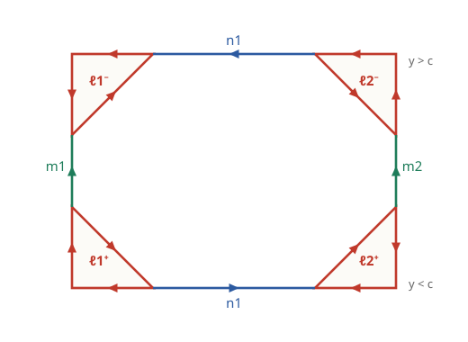
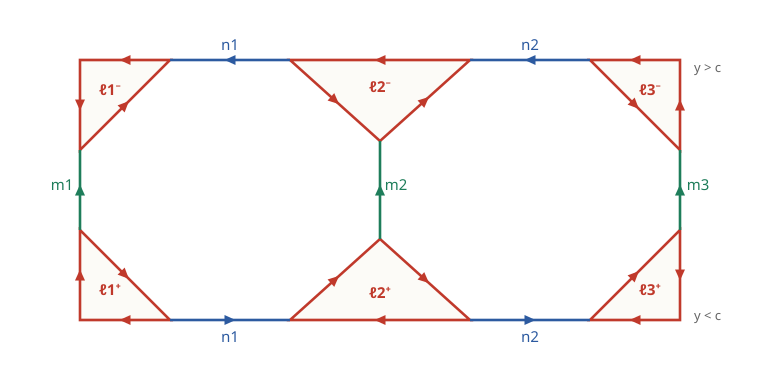
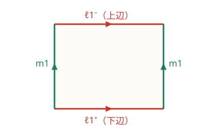
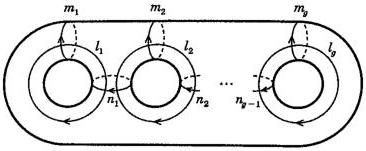

<!-- XQQQ1500000 -->
# LickorishCodes の規約

対象はモジュール `LickorishCodes`（型 `LickorishCode`）である。モジュール構成は[モジュール構成 §1](../specs/module-structure.md#1-構成)に従う。移行中のため、コードは現在 `src/heegaard/` の `HeegaardCodes` の中にある。

このページは平面図の規約の全文と、このモジュールの他の規約の一覧を持つ。一覧の各項目の定義は、リンク先の仕様の節にある。

## 平面図

状態は `draft`（あかげふの確認待ち）。

### 前提とする対象

- Σ_g は向き付き閉曲面である。K = {ℓ_i, m_i, n_i} は Σ_g 上の向き付き単純閉曲線で、`lickorish_reference(g)`（[`src/heegaard/reference_surface.jl`](../../src/heegaard/reference_surface.jl)）と [LC 仕様 §2](../specs/lickorish-code.md#2-lickorish-基準曲線網-k) が定める。m_i は ℓ_i と 1 点で交わり、n_i は ℓ_i と ℓ_{i+1} に 1 点ずつで交わる。
- 交点の符号: 交点 k で、曲線語に +k を持つ曲線の接線を t_a、−k を持つ曲線の接線を t_b とする。向きを保つ局所座標で det(t_b, t_a) > 0 である（[LC 仕様 §3](../specs/lickorish-code.md#3-lc-のデータ形式gauss-code-形式)）。言い換えると、+k の曲線は −k の曲線をその右から左へ横切る。

### 定義

- **切断面 S**: Σ_g を ℓ_1, …, ℓ_g に沿って切った曲面。境界成分は 2g 個ある。
- **ℓ_i⁺、ℓ_i⁻**: ℓ_i から生じる S の二つの境界成分。ℓ_i の左側にある方を ℓ_i⁺、右側にある方を ℓ_i⁻ とする。m_i は ℓ_i を右から左へ横切るので、S の上の弧として ℓ_i⁺ から出て ℓ_i⁻ に入る。
- **平面図**: S から一点 ∞ を除いたものの、向きを保つ平面への埋め込み。平面には x 右向き・y 上向きの座標を取り、その標準の向きを使う。

### 規則（g ≥ 2）

- ∞ を置く面は、Σ_g ∖ K の g 個の面から選ぶ。既定は m_1 の左側にある面である。現在の描画器は既定の面だけを実装している。∞ は図を展開する点であり、曲線の同位で固定する基点ではない（[立体表示の仕様 §2.2](../specs/heegaard-solid-view.md#22-無限遠点と図の幾何)）。
- ℓ_i⁺ と ℓ_i⁻ は、ある水平線 y = c に関する鏡映 (x, y) ↦ (x, 2c − y) で互いに移り合う。貼り合わせはこの鏡映で行う。ℓ_i⁺ は y < c の側に置く。
- ℓ_1⁺, …, ℓ_g⁺ を、i の順に x の小さい方から並べる。
- 境界成分は三角形で描き、最終表示では内接円に移す（[LC 仕様 §6.2](../specs/lickorish-code.md#62-表示の幾何種数-g--2)。三角形と内接円の表示はあかげふの既定、[LC 仕様 §10](../specs/lickorish-code.md#10-未確定事項)）。

### 帰結（g ≥ 2）

以下は、定義と規則から決まる性質である。∞ は既定の面に置いたものとする。

- ℓ_i⁺ は時計回りの円周になる。曲面 S が ℓ_i の左側にあるからである。ℓ_i⁻ は反時計回りになる。
- m_i は ℓ_i⁺ から ℓ_i⁻ へ、y の増える向きに進む。
- y < c の側では、n_i は x の増える向きに進み、ℓ_i⁺ から ℓ_{i+1}⁺ へ向かう。y > c の側では、x の減る向きに進む。
- 1 < i < g のとき、ℓ_i⁺ を時計回りにたどると、K と m_i, n_i, n_{i−1} の順で交わる。

これらは [Julia の回帰テスト `LC display convention`](../../test/heegaard/hc_plot.jl) で、種数 2 と 3 について確かめている。

次の図は、定義と規則をそのまま描いたものである。赤は ℓ、緑は m、青は n を表す。境界成分は §6.2 の三角形で描いた。点線の長方形の外側が ∞ を含む面である。

### 種数 1

Σ_1 を ℓ_1 と m_1 に沿って切ると、長方形が得られる。ℓ_1 を x の増える向きに置くと、ℓ_1⁺ は下の辺、ℓ_1⁻ は上の辺になる。どちらも x の増える向きに進む。m_1 は左右の辺で、y の増える向きに進む。

### 画面座標

SVG と Makie は y 下向きの画面座標を使い、描画器の配置座標もこの画面座標である。画面に表示された図は、上の平面図と同じ向きに見える。画面座標で det(t_b, t_a) を計算すると、上の符号は反転する。各出力の向きは [Makie のテスト](../../test/heegaard/hc_drawing.jl) と [Python の SVG テスト](../../test/test_lc_render_frame.py) で確かめている。

### 原典との対応（未了）

原典は [[AS13#^anonnd60-sec-0740]] の [p.244 図 12.3（PDF p.251）](../../../../references/items/book/w-a3c2a004-c587-4cfd-ae05-b73a924d15d7/sources/original/mapping-class-groups-cover.pdf#page=251) である（[文献項目 AS13](../../../../references/items/book/w-a3c2a004-c587-4cfd-ae05-b73a924d15d7/item.json)）。この図は曲面を立体として描いており、平面図との対応は[立体表示の仕様 §3.1](../specs/heegaard-solid-view.md#31-共通の位置と曲面の向き)に従う。Σ_g の向きと K の各曲線の向きが図の矢印と一致するかは、まだ確かめていない。図の実線の n には左向きの矢印が描かれており、これを確かめる必要がある。

## このモジュールの他の規約

| 規約 | 定義の場所 | 状態 |
|---|---|---|
| LC と HC のレイヤーの区別。語と `place` は LC に属する | [LC 仕様 §1.1](../specs/lickorish-code.md#11-レイヤー構造あかげふの決定2026-11-09)、[用語と記号](../specs/heegaard-terminology.md) | あかげふの決定 2026-11-09 |
| 交点の符号（passage sign）と曲線語の書式 | [LC 仕様 §3](../specs/lickorish-code.md#3-lc-のデータ形式gauss-code-形式) | 仕様 |
| 細分領域番号 F1, F2, … を `ρ ∘ τ` の軌道で付ける | [LC 仕様 §3.1](../specs/lickorish-code.md#31-交点を持たない曲線と-place) | あかげふの決定 2026-11-16 |
| 平面図と立体の対応（観察者は手前、∞ は背面、P の向きは LC の向き） | [立体表示の仕様 §3.1](../specs/heegaard-solid-view.md#31-共通の位置と曲面の向き)、[同 §2.3 の規約図](../specs/heegaard-solid-view.md#23-あかげふが示した規約の図) | あかげふの指定 2026-11-11 |
| 描画の既定値（点の間隔など） | [LC 仕様 §6.3](../specs/lickorish-code.md#63-工程) | あかげふの確定 2026-11-07 |
<!-- XQQQ1000000 -->
