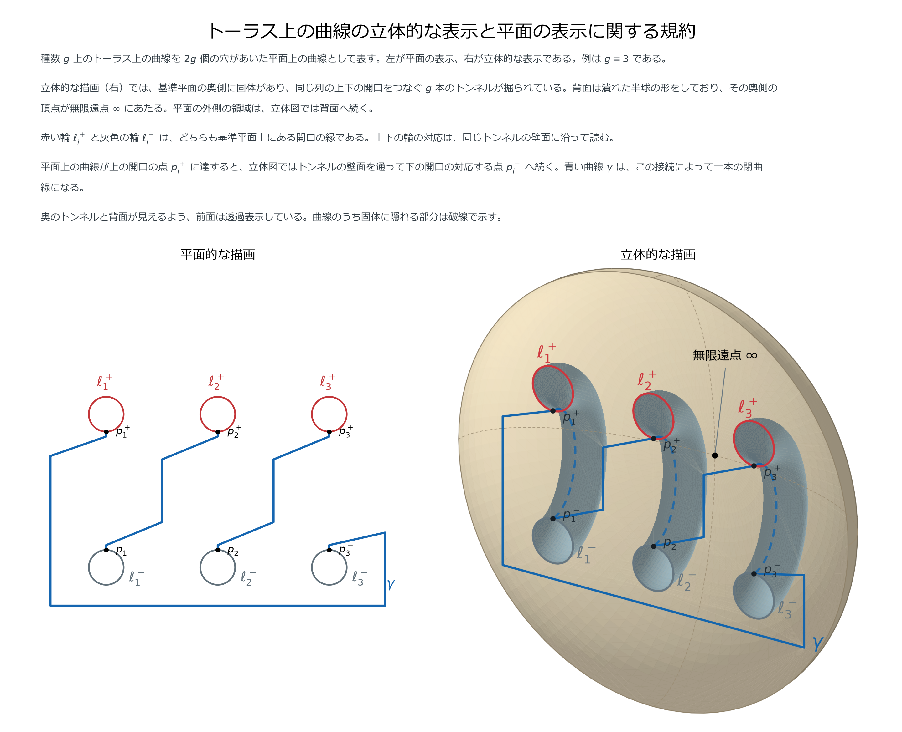

<!-- XQQQ1500000 -->
# 平面の図と立体の対応規約

Status: 主表示と対象範囲はあかげふの指定（2026-11-11）。定義・規約・照合手順の正本。数学的根拠の確認先は §8、個々の原図と実装の状態の確認先は §9 
Scope: Lickorish Code の平面図を立体へ運ぶ対応、表示する固体、原図との照合手順 
Audience: 仕様策定、原図の転写・照合、描画の利用と実装 
Owner context: 東京科学大学 情報理工学院 数理・計算科学系 鈴木咲衣研究室

## 1. 確定事項の範囲とデータの境界

§1–7 は定義・規約・照合手順を定める。§8 は数学的根拠と検証資料の読み方、§9 は変わりうる状態・未決事項の参照先、読む時点、判断者を定める。実装や受入の最新状態は §9 の参照先で確認する。

原図との照合では、球にトンネルを掘った表示を主表示とする。球にハンドルを手前へ付加する 2026-10-26 の表示は、互換の表示として保持する。本書を両表示の対応規約の正本とする。

[Lickorish Code の仕様](lickorish-code.md) が向き付き曲面・基準曲線網 K・曲線の語・place を定め、[HeegaardCode の仕様](heegaard-code.md) が α・β の役割と追加情報を定める。本書は、その同じ曲面上のデータをどの立体の境界へ写すかを定める。表示する固体の選択と、曲面上の配置の変更を区別する。

ライブラリの今回の成果物は平面の `plot` である。その描画規約・データ形式は維持する。提案書の三種類の表示モード、`view:` スキーマ、立体の描画器は今回の実装範囲に含めない。立体の描画器は、原図との照合で必要になった時点で追加する。用語は [Heegaard の用語と記号](heegaard-terminology.md) に従う。

本文の `l_i` と数式の $\ell_i$ は同じ基準曲線を表す。用語・記号を図で確認するときは、研究リポジトリ基準 `threads/PJ260922/docs/reports/261111-lc-hc-explainer.html` の「平面図に基準曲線を置く」と「種数3：6個の穴を通る曲線の語を読む」を参照する。本書の開口は、同説明書が平面図で「穴」と呼ぶ部分に対応する。数学的な同位の記述は向き付き曲面と曲線配置を前提とする。以下の表示模型は、互いに素な円板によって**同時に境界平行**にできるトンネルの弧族を使う。

## 2. 平面の表示と開口の対応

### 2.1 切断した曲面

<!-- XQQQ1500000 -->
種数 $g\geq1$ の曲面 $\Sigma_g$ を $\ell_1,\ldots,\ell_g$ で切ると、境界成分を $2g$ 個持つ球面になる。その一点を無限遠点として平面へ展開したものが、ここでいう平面の表示である。同じ列の下段の開口の縁 $\ell_i^+$ と上段の開口の縁 $\ell_i^-$ を対にする。添字、基準曲線の向き、上下の点対応 $(x,y)\mapsto(x,-y)$、K の経路は [LC 仕様 §2](lickorish-code.md#2-lickorish-基準曲線網-k) を参照する。
<!-- XQQQ1000000 -->

曲線が上の縁の点 $p_i^+$ に達したとき、対応する下の点を $p_i^-$ とする。平面では二つの端点として描き、立体では間の円環上の弧でつなぐ。複数の通過がある場合も、各点と縁に沿う順序をこの対応で運ぶ。上付きの $+$・$-$ は切断の両側を表し、LC の passage sign と区別する。

数学的な切断では $p_i^+,p_i^-$ は同じ切断点の二つの写しである。開口を実際に離して描く立体模型では、切断線の円環近傍を広げ、二つの縁をその両端へ移している。このため、立体の $\ell_i^+,\ell_i^-$ は互いに平行な二つの円周であり、$\ell_i$ の同位類を代表する。円環の幅を戻す対応と、曲線の接続を合わせて記録する。

### 2.2 無限遠点と図の幾何

平面の外側の領域は、立体では球の背面へ続く。無限遠点 $\infty$ は、扁平な背面の半球の奥側の頂点に置く。これは**曲面上の図の無限遠点**であり、後述の $S^3=\mathbb R^3\cup\{\infty_3\}$ の空間の無限遠点 $\infty_3$ とは別の点である。画面の外枠は曲面の境界を表さない。

三角形の穴、円への写像、種数 1 の正方形、外側領域の配置は [LC 仕様 §6](lickorish-code.md#6-描画アルゴリズム規範) が定める。本書の $2g$ 開口は立体との位相的な対応であり、種数 1 の `plot` を二穴表示へ変更する指示ではない。種数 0 では開口もトンネルもなく、球面と球を用いる。

LC 単独では $\infty$ は図を展開する点であり、曲線の同位が固定する基点ではない。原図が特定の外側領域・無限遠点を印として指定する場合は、その対応も照合記録に加えて保つ。これは、旧規約で保存を要求した原図の外側領域と、LC の図を展開する点の自由を区別するためである。

### 2.3 あかげふが示した規約の図

あかげふが 2026-11-11 に示した「トーラス上の曲線の立体的な表示と平面の表示に関する規約」の画像を、提供 HTML から PNG のまま抽出した。左が平面、右が主表示である。赤と灰色の輪はいずれも基準平面上の開口の縁である。青い曲線は対応する点の間をトンネル壁面でつなぐ。この図は規約の説明であり、特定の文献図の転写を認証する資料とは区別する。

## 3. 立体の表示

### 3.1 共通の位置と曲面の向き

基準平面を $z=0$、観察者側を $z>0$ とする。基準球 $B$ は $z\leq0$ にあり、平らな前面と扁平な背面を持つ。前面の開口以外の部分では、両表示の曲面を同じ側から見る。互換表示では、付加したハンドルの部分が $z>0$ へ張り出す。

開口を除いた球面部分を $P$、列 $i$ の上下を結ぶ円環を $A_i$ とする。共通の抽象曲面は $P$ と $A_1,\ldots,A_g$ を所定の境界対応で貼ったものである。P の向きを LC の向きに一致させ、円環へ連続に延長する。両表示の対応は、P 上で恒等、各円環上で同じ周方向・長手方向のパラメータを保つ写像とする。これで K と全曲線を運ぶ。

この対応は向きを保つ。向きは連結曲面の P 上で一致しており、その延長も一致するためである。局所の枠、passage sign、巡回語は保存される。以下でいう「ねじれなし」は、この円環の対応を使うことを意味する。

ここで固定するのは、抽象曲面の LC の向きを各境界へ運んだ向きである。向き付き固体から「外向き法線を先に置く」規則で誘導される境界の向きとは区別する。別々に置く両模型の三次元の向きは、それぞれの誘導境界向きが LC の向きと一致するように選ぶ。同じ空間で相補的な二領域を扱うときの向きは §3.4 に従う。基準曲線の向きと交点の符号は LC 仕様に従い、表示を変える際にも保つ。

### 3.2 主表示：球にトンネルを掘る

各列の上下の開口を結ぶ、B 内の適切に埋め込まれた弧を $\gamma_i$ とする。弧の端点は球面上、内部は球の内部にある。$\gamma_i$ と前面上の同列の弧 $a_i$ が、互いに素な円板 $E_i$ の境界をなす配置を標準とする。トンネル $N_i$ は $\gamma_i$ の細い正則近傍であり、端の二円板で球面と交わる。表示する固体は、トンネル内部を除いて閉包を取った

$$
H_{\mathrm{drill}}=\overline{B\setminus\bigcup_i N_i}
$$

である。境界は P と、除去した管の側面 $A_i$ からなる。$A_i$ は残った固体にとってトンネルの壁面である。$p_i^+$ から $p_i^-$ へはこの壁面を通る。

正則近傍は円板系に適合させる。各円板と対応するトンネル近傍との共通部分を、その円板内で弧に沿う閉じた collar とし、他のトンネル近傍とは交わらないように取る。

$E_i$ からトンネル近傍を除いた部分は、境界が $m_i$ である埋め込み円板 $\Delta_i$ になる。ここで $m_i$ は、トンネル壁を通る弧と、P 上で同列を戻る標準の弧を合わせた曲線である。K の $m_i$ はこの代表元の同位類に対応させる。$\Delta_i$ は完全メリディアン円板系であり、これに沿って切ると球になる。

この円板は、近傍の内部を除いた残りの閉包、すなわち元の円板と残存固体の共通部分である。境界の平面側は開口の分だけ短くなった弧で、円環側は指定した長手方向の弧である。円板に沿って切る操作は、互いに素な bridge disk に沿って境界平行なトンネルを順に開く操作に対応し、最後に球が残る。

したがってこの固体のメリディアンは $m_i$ である。開口の縁 $\ell_i^\pm$ は、除去した $N_i$ 側で断面円板を張る。残った $H_{\mathrm{drill}}$ 内では非可縮である。背面と曲面の無限遠点は §2.2 の位置にある。

### 3.3 互換の表示：球にハンドルを手前へ付加する

2026-10-26 の指定に従い、B に互いに絡まない $g$ 本の 1-handle $D^2\times[0,1]$ を付加する。各ハンドルは同じ列の上下の開口に付き、$z>0$ へ張り出す。表示する固体は

$$
H_{\mathrm{att}}=B\cup\bigcup_i(D^2\times[0,1])_i
$$

である。境界は P とハンドル側面の円環 $A_i$ である。上下の点を結ぶ円環のパラメータ、観察者、基準球、背面の無限遠点は主表示と共通とする。

ハンドルの断面円板の境界 $\ell_i$ がメリディアンである。$m_i$ はハンドルを一度通って P 上を戻り、固体内の自由群の生成元を表すので非可縮である。旧説明図はハンドル中央の断面に $\ell_i$ を置いていた。その円周と開口の縁は側面円環内で平行であり、円環近傍を広げる §2.1 の対応で読み替える。旧図の生成プログラムは履歴資料として読む。

### 3.4 同じ印つき曲面と、異なる固体の側

両表示は、§3.1 の同定によって同じ向き付き曲面・K・曲線配置を持つ。一方、境界から固体への包含がホモロジーに誘導する写像の核は、整数係数で

$$
\ker\bigl(H_1(\Sigma_g)\to H_1(H_{\mathrm{att}})\bigr)
 =\langle[\ell_1],\ldots,[\ell_g]\rangle,\qquad
\ker\bigl(H_1(\Sigma_g)\to H_1(H_{\mathrm{drill}})\bigr)
 =\langle[m_1],\ldots,[m_g]\rangle
$$

となる。付加側はハンドルの芯の花束へ縮められ、$m_i$ が自由生成元になる。掘った側は $\Delta_i$ に沿って切ると球になり、$\ell_i$ が各円板を一度横切る自由生成元になる。この構成が核の式の根拠である。$g\geq1$ では核が異なるため、§3.1 の曲面の同定は、この二つの固体間の同相へ延長できない。

主表示を $S^3$ の中に置くと、その補側は外側の球 $B_{\mathrm{ext}}=\overline{S^3\setminus B}$ と、除いたトンネル $N_i$ の和である。これは球に $g$ 本のハンドルを付加したものとなり、$\ell_i$ がメリディアンになる。したがって主表示は、標準的な $S^3$ の Heegaard 分解で、互換表示の型に対する反対側のハンドル体を示す。これは両模型の**側と圧縮円板系の対応**であり、基準平面を固定したまま固体全体を同位変形するという主張ではない。

一つの向き付き $S^3$ の中で隣接する両領域から誘導される境界向きは、共有境界の同じ点を対応させると互いに逆になる。掘った側の誘導境界向きを LC の向きに合わせれば、同じ点対応で補側から引き戻した誘導境界向きは LC の向きの逆である。§3.1 の互換表示をこの実際の補側へ同じ境界座標で対応させる同相は、三次元の向きを反転する。

§3.1 は、別々に表示した模型を共通の LC 曲面へ対応させる規約である。補側を一緒に描く場合には、その誘導境界向きの反転を明示する。passage sign と巡回語は LC の向きから計算し、塗りつぶした領域から自動的に取り直さない。両固体は抽象的にはともに種数 g のハンドル体であり、ここで示した相違は指定した境界同定の非延長性である。核の相違は延長を妨げるが、核の一致だけを一般の延長の証明には使わない。

**Evidence.**

- proof: self（§3.1–3.4 の標準弧族と円板系による論証）

## 4. 表示を変えたときに保つものと変わるもの

| 対象 | 主表示：掘る | 互換表示：付加 | 対応の扱い |
|---|---|---|---|
| 向き付き曲面、K、全曲線の配置 | 共通の $\Sigma_g$ 上のデータ | 同左 | §3.1 の写像で保存 |
| 平面図の列、上下、開口の対、通過点 | LC の対応 | 同左 | 保存 |
| passage sign、巡回語、place | LC の値 | 同左 | 表示の変更だけなら保存 |
| α・β の role、disk・point・weight | HC の値と支持 | 同左 | 保存 |
| 基準球・観察者・曲面の無限遠点 | 球は奥、観察者は手前、無限遠点は背面 | 同左 | 保存 |
| 円環の空間内の位置 | 球の内部のトンネル壁 | 球の手前のハンドル側面 | 変更 |
| 表示する固体 | 球から管を除いた領域 | 球と付加したハンドル | 変更 |
| メリディアン円板の境界 | $m_i$ | $\ell_i$ | 変更 |
| 空間の投影、遮蔽、破線、陰影 | 掘った側の幾何から決まる | 付加側の幾何から決まる | 変更。投影交差を曲面の交点へ加えない |

この表の「保存」は、同じ marking を使う表示変更について述べる。原図から別の marking を選ぶ操作や、曲線への Dehn twist は §6・§7 に従って別に記録する。

## 5. α・β と `standard`

α・β は HeegaardCode が曲線に指定する役割である。表示の切替えで α と β を交換しない。表示から role を推定しない。一般の Heegaard diagram では、見えている標準固体が α 側・β 側のどちらを表すかは、指定された切断系と境界の marking を確認して述べる。

[公開型の仕様](heegaard-diagram.md) にある `standard` は、α の支持を既存の $m_i$ に束縛する入力略記である。この場合、主表示のメリディアン円板が α の圧縮円板になり、見えている固体を α 側として解釈できる。互換表示のメリディアンは $\ell_i$ なので、同じ理由による α 側の解釈は成り立たない。互換表示を β 側と呼べるかどうかは、β の指定による。

ここで標準 $S^3$ の補側を用いたのは基準曲面の二つの固体模型の説明である。任意の HC が表す三次元多様体の両側を、この $S^3$ の分解と同一視するものではない。`standard` の入力略記と、Koda の standard punctured Heegaard diagram の条件も、[HC 仕様](heegaard-code.md)・[Koda 変換仕様](heegaard-koda-conversion.md) が定める別の条件である。

## 6. ねじれと語の変化

標準の円環を $(\mathbb R/\mathbb Z)\times[0,1]$ とし、$t=0$ が上、$t=1$ が下、$s$ が縁に沿うパラメータとする。標準接続は $s$ 一定の弧である。ここで $p_i^+$ と $p_i^-$ の対応に、余分な周回を加えないことを「ねじれなし」とする。

円環の両境界を固定する整数 $q$ 回のねじれは

$$
T_q(s,t)=(s+qt\bmod1,t)
$$

で表せる。符号を使う際には円環の向きとこの座標の対応を記録し、[move 仕様 §6.2](heegaard-moves.md#62-lc-の-dehn-twist-と逆) に従う。整数回のねじれは両端の点対応を保つので、上下の点が合うことだけでは $q=0$ を確認できない。長手方向の弧、すなわち $m_i$ の経路も照合する。

固定した K に対して曲線に $T_q$ が作用すれば、$\ell_i$ に沿う Dehn twist としてその配置を読み直し、LC の語へ反映する。種数 1 で $m$ を一度ねじった曲線は、向きの選択に応じて $[m]\pm[\ell]$ となり、掘った固体内で非零のホモロジー類を持つ。この曲線を標準のメリディアン $m$ と同一視すると、§3.2 の円板の説明と食い違う。

管の外形や投影上の曲がりだけから整数 $q$ は決まらない。また、K と全曲線を同じ写像で運ぶ場合には、それらの相対的な語は保たれる。ねじれがあっても、作用を受けない曲線の語は変わらない。語の変更は、**固定 K に対する曲線の円環内の巻数が変わる場合**に記録する。原図が巻数を指定していない場合は、採った巻数とその根拠、または未確定であることを記録する。

巻数は標準の長手方向の弧に対する相対的な同位類として読む。円環の全パラメータ、または両端を指定した長手方向の弧が与えられれば、その持ち上げの周方向の変位から整数を求める。m_i の経路と巻数をともに記録するときは、同じ接続を表すことを確認する。

K と全曲線の同時輸送による語の保存は、曲面上の性質である。掘った固体では、非零の q 回のねじれで m_i の整数ホモロジー類に ±q 倍の ℓ_i の類が加わり、§3.4 の核が保存されなくなる。その境界写像は、固定した marking の下では掘った固体の自己同相へ延長できない。

## 7. 原図と照合するときの手順

### 7.1 曲線を比べる前の確認

marking は、標準曲面から原図の曲面への、指定した印を保つ向きを保つ同相写像の同位類である。固定する点は点ごとに保ち、固定する領域や曲線はラベルを保って集合として保つ。同位の間もこれらの条件を課す。固定する印の種類と対応を、曲線を動かす比較に先立って指定する。

下表の順に原図の読みを確定し、対応表を作る。原図の見えない部分について採用した仮定は、読めた事実と分ける。

| 順 | 確認する対象 | 記録する内容 |
|---|---|---|
| 1 | 原図の出典 | 著者・題名・図番号・頁・キャプション、使用した画像。書誌未確定ならその範囲 |
| 2 | 穴の一対一対応 | 描画の $(i,+),(i,-)$ と原図の各開口の対応。原図に番号がなければ注釈で位置を指す |
| 3 | 上下と対 | 原図のどの開口を上・下に読むか、どの二つを一つのトンネルの両端に読むか |
| 4 | 貼り合わせとねじれ | 縁の点と巡回順の対応、長手方向の弧、整数巻数。原図の証拠と標準を補った箇所 |
| 5 | 見えている固体 | 掘った残存領域か、付加した側か、その他か。円板を張る曲線と、原図の α・β 指定の有無 |
| 6 | 観察方向と画像操作 | 観察者の側、平面の回転、空間の回転、鏡映、上下の交換。適用した操作と向きへの効果 |
| 7 | marking | 向きを保つ $f:\Sigma_g\to S_R$。穴と点の対応に加え、$\ell,m,n$ の経路、円環のねじれ、必要な外側領域・印 |

鏡像を使った場合は、それを明示して曲面の向きと符号への作用を計算する。画像の上下反転と、同じ向き付き曲面を空間内で回転させる操作は、それぞれの対応として記録する。投影で交わる線は、曲面上でも同じ点か、遮蔽による見かけの交差かを分ける。

ℓ_i・m_i・n_i の対応は、曲線のラベル、向き、交点、各交点での巡回順序、辺の埋め込み経路を持つデータとして記録する。ホモロジー類だけでは marking は決まらない。K の像から marking を指定するときは、この全グラフ対応と補領域の対応を与える。K の構造と補領域は LC 仕様で確認し、個々の原図でその対応が実現されていることを確かめる。

### 7.2 一致の意味

原図の曲面を $S_R$、その曲線配置を $D_R$、描画した標準曲面上の配置を $D_L$ とする。§7.1 で指定した marking $f$ の下で、$\Sigma_g$ 上の ambient isotopy $h_t$ が

$$
h_0=\mathrm{id},\qquad h_1(D_L)=f^{-1}(D_R)
$$

を満たすことを「その対応の下での一致」とする。成分の向きと対応、HC がある場合の α・β の役割、比較対象に指定した印も保つ。曲線配置**全体**を一緒に動かす条件であり、各曲線を別々に動かして交点を増減する比較とは区別する。

この同位の間、§7.1 で固定すると指定した点・領域・曲線は、そこで指定した条件で保つ。HC の支持を持つ追加情報は配置とともに運び、そのうち固定対象に指定したものには固定条件も課す。座標系としての K は、比較の固定対象に指定した場合を除き、同位写像が点ごとに保つ対象とはしない。

marking は比較する曲面を固定する。同位の途中で曲線が固定 K を横切ることは許されるため、一致に LC 文字列の同一性は要求しない。同じ座標・曲がり方も要求しない。代わりに、穴に対する経路と配置全体の同位を、切断後の弧の対応や明示した変形で確かめる。K を忘れた図式の同相や多様体不変量の一致は、この確認を代用しない。

### 7.3 対応を一意に決められない場合

穴の対応だけでは、穴を固定する Dehn twist や P 内の経路の自由度が残る。原図に K がなければ、補った基準曲線を「採用した marking」として明示する。一致の証拠は、その marking の下で原図の曲線を独立に辿ったものとする。出力に合うよう選んだ同相から K を引き戻しただけの比較は、原図からの独立な照合にならない。

複数の対応が可能な場合には、採った対応と残る候補を記録し、結果を「その対応の下での一致」として報告する。候補を一つに決められず曲線の経路が変わる場合は、未確定箇所を残す。異なる marking を同等として扱うときは、許す変換の集合または群と、その採用判断を別に指定する。

個々の原図の照合では、採用した marking、独立に辿った曲線、配置全体の対応を記録する。条件付きの一致の採否と既存例の受入状態は、§9 の参照先と判断者に従う。

### 7.4 照合の記録と判定の進め方

あかげふの指示（2026-11-14）。§7.1 の表を、例ごとの必須の記録として運用する。判定は、この記録が揃ってから行う。記録のない「一致」は判定として扱わない。

各例の記録は次の六つを持つ。

1. **全体の変換。** 原図の画像から描画の座標への回転角と鏡映の有無。あかげふや判定者に見せる比較画像は、この変換を適用して原図と描画を同じ向きに揃えたものとする。揃えていない比較画像は判定に使わない。
2. **開口の対応。** 描画の各開口 $(i,\pm)$ が原図のどの穴か（注釈つきの原図で位置を示す）、どの二つの穴が一つのハンドルの両端か、縁の巡回順の向きが同じか逆か。
3. **曲線の対応。** HC の各 α・β が原図のどの曲線か（色やラベル）。原図の α が対になった穴を結ぶ線分であれば、`standard` の形で書き、α を $m_i$ または $\ell_i$ に束縛する。
4. **交点のラベル。** α と β の交点に、原図の注釈と描画の両方で同じラベルを付ける。
5. **曲線ごとの読み。** 各曲線について、交点と開口を通る巡回列を、HC を見ずに原図から独立に読む。同じ列を HC から読み、両者を機械的に比べて違いを列挙する。
6. **判定。** 1〜5 が揃い、5 の違いが 0 件のときだけ「一致」とする。違いがあれば、その箇所を挙げて「不一致」とする。

### 7.5 原図から HC を書き起こす手順

あかげふの指示（2026-11-14）。原図から LC・HC を作るときは、次の順で進め、各段の結果を記録する。

1. **全体の変換を特定する。** 原図を規約の主表示へ置くための回転と鏡映を決める。図だけで決まらないことが多いので、キャプション・本文・同じ論文の他の図も根拠に使い、根拠を記録する。決まらなければ候補を残す。
2. **基準曲線を引く。** 開口の対応（§7.4 の 2）を決め、原図の上に K（$\ell_i, m_i, n_i$）を引いた注釈図を作る。
3. **交点に記号を割り当てる。** 原図の曲線どうしの交点と、曲線と K の交点に、$V_1, V_2, \ldots$ の記号を振った注釈図を作る。
4. **トレースして LC を得る。** 各曲線を辿り、通る交点の記号の巡回列と符号を書く。これが LC の語になる。
5. **曲線にラベルを割り当てる。** 各曲線に $\alpha_1, \ldots, \beta_1, \ldots$ の役割を割り当て、HC にする。

原図の α が、対になった開口を結ぶ線分（$m_i$）または開口の縁（$\ell_i$）と同じ曲線になっていれば、`standard` の形で書く。原図が α を摂動させて描いている場合（線分から小さく外れて交点を作っている場合など）は、まず原図のとおりに一般の形で書き起こす。そのうえで、α を β との交点を変えずに $m_i$ または $\ell_i$ へ移せるかを判定し、移せるときだけ `standard` に書き直す。摂動が交点の順や個数に効いているなら、一般の形のまま残す。

注釈図（2 と 3）はあかげふに見せる比較画像と同じ向きで作り、§7.4 の記録に添える。書き起こしは画像を読む力の要る作業なので、担い手をあかげふの指定に従って選ぶ（§9 の参照先）。

役割を分ける。HC を書いた者と判定する者は別にする。判定者（GPT Pro を含む AI agent）は、5 の原図の読みを HC より先に行い、この記録の形で答える。あかげふに判定を依頼する AI agent は、比較画像を自分で開き、記録の 1〜5 が揃っていることを確かめてから渡す。確かめていない判定を、あかげふ向けの資料に「一致」や「判定案」として載せない。

## 8. 根拠と検証資料の読み方

本書の定義・規約の根拠と、個別の検証結果を次のとおり区別する。定義と手順そのものは §1–7 に置き、この節には再掲しない。

| 区分 | 確認する箇所 | 根拠の範囲 |
|---|---|---|
| あかげふの決定 | 2026-11-11 の本レーンへの直接指示、§1 | 主表示と今回の対象範囲 |
| 既存の決定・仕様 | §1・§2・§5 から参照する各正本 | LC・HC のデータの意味。利用時に現行版を読む |
| `proved/agent` | §3 の構成と円板系の論証、§6 の円環上の写像 | 同時に境界平行な標準弧族。あかげふの証明確認は別に記録する |
| 有限計算 | 下記スクリプトと、その実行で生成した結果 | 指定した種数・模型・係数体・曲線に限る。実行日時と hash を結果で確認する |
| Pro の助言 | §9 のレビュー資料 | 採用前に論証または小例で確認する。返答自体を証拠に数えない |

有限検証は、種数 1・2 の直方体の球と U 字の立方体列から、掘る模型と付加する模型を構成する。全セルの境界行列から F₂ ホモロジーと境界曲線の像を計算し、零となる曲線には具体的な埋め込み長方形円板を指定する。非零の像による非可縮性と、円板の構成による可縮性を区別する。さらに整数係数の境界作用素で、球面部分を固定して円環を対応させる写像と、一つの空間で相補的な領域の境界を同じ点として同一視する写像を別々に検査する。実装・結果・前回との比較は下表の資料で読む。スクラッチの出力は再実行資料であり、恒久的な証拠登録と親の独立受入は §9 の参照先で確認する。

以下のパスは研究リポジトリのルートを基準とする。

| 読む時点 | 資料 |
|---|---|
| メリディアンの有限検証を再現するとき | `.research-scratch/PJ260922/astra-lanes/spec-view/261111-verify-solid-view.py` と同名の `.json`。実行コマンドと環境は JSON に記録する |
| 向きの二種類の対応と、1 回のねじれのホモロジーを確認するとき | `.research-scratch/PJ260922/astra-lanes/spec-view/261111-check-view-orientation.py` と同名の `.json`。先に前行のスクリプトを実行する |
| 第 1 回とサンドボックス解除後の結果を比較するとき | `.research-scratch/PJ260922/astra-lanes/spec-view/261111-verify-solid-view-round2-comparison.json` |
| あかげふの提供図の出所を確認するとき | `.research-scratch/PJ260922/astra-lanes/spec-view/261111-materials-receipt.json`。提供 HTML と抽出 PNG の hash を記録する |

## 9. 変動情報・未決事項の参照先と判断者

この節は、作業状況や未決の選択の内容を複製せず、どこを・いつ読むかと誰が決めるかを定める。以下のパスは研究リポジトリのルートを基準とする。

| 確認する対象 | 読む場所と時点 | 判断・更新の担当 |
|---|---|---|
| LC・HC の形式、`standard` の構文と意味 | 入力を読む・作る・修正するときに `lib/topology.jl/docs/specs/lickorish-code.md`、`lib/topology.jl/docs/specs/heegaard-code.md`、`lib/topology.jl/docs/specs/heegaard-diagram.md` の現行版を読む | 各仕様の担当。あかげふの決定に従う |
| 平面 `plot` と立体描画の実装・試験状況 | 実装を使う前に `threads/PJ260922/ACTIVE.md` の作業先を辿り、その担当の最新報告と `threads/PJ260922/LEDGER.md` の受入記録を読む | 実装担当が報告し、親が独立判定する |
| 個々の原図の穴の対、ねじれ、K の経路、固体の側 | 原図照合を始める前に `threads/PJ260922/ACTIVE.md` から該当例の原図・対応表・照合記録を辿る。候補が複数なら §7.3 の記録を読む | 照合担当が根拠と候補を記録する。marking の選択と許す変換の範囲はあかげふが決める |
| 絡むトンネルへの適用可能性 | 原図を標準模型へ対応させる前に、該当例の埋め込みと互いに素な bridge disk の証拠を読む | 照合担当が §3.2 の仮定を確認し、親が検証を判定する。仮定を確認できない例は適用未確定として残す |
| 書誌未確定の図、見えない部分 | 文献上の主張を採用する前に、該当例の出典記録と原図・キャプションを読み、取得手順は `docs/LITERATURE.md` に従う | 資料担当と照合担当。画像の対応と文献上の根拠を分けて記録する |
| 条件付きの一致の採否、HB3・HB6 の受入 | 例を閉じる直前に `threads/PJ260922/ACTIVE.md` の条件と `threads/PJ260922/LEDGER.md` の親の判定を読む | あかげふが採用条件を決め、親が各例を独立に判定して記録する |
| Pro のレビューと本レーンの確認結果 | 仕様を再検討するときに `.research-scratch/PJ260922/astra-lanes/spec-view/answer-1-full.md` の `Answer:` より後と、同フォルダの最新の作業報告を読む | 本レーンが助言を検証し、親が変更を確認する |
<!-- XQQQ1000000 -->
