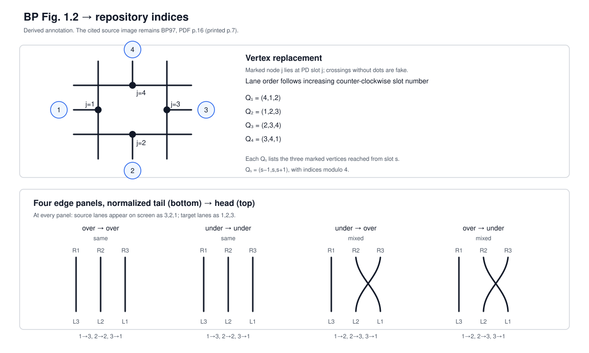

# C2 graph: BP Figure 1.2 and implementation indices

Status: source figure and all four local lane traces independently transcribed;
raw dual-partition comparator passed on 500 production-computed records  
Scope: the underlying normal o-graph with at least one true vertex; edge
weights are outside C2 and no weighted equivalence is inferred  
Terminology: [`ograph-terminology.md`](ograph-terminology.md)

## Source statement

Benedetti--Petronio define a normal o-graph by N1--N2 and impose C1--C3 for
the closed case. C2 says that the trivalent graph produced by the rules of
Figure 1.2 is connected. The exact local rule is the cited figure, not an
implementation-derived formula.

- Work: `[[BP97]]`, Benedetti--Petronio, *Branched Standard Spines of
  3-manifolds* (1997), DOI `10.1007/bfb0093620`.
- N1--N2 and C1--C3: `[[BP97#^bp97-sec-0015]]`, PDF p.15 (printed p.6).
- Defining figure: `[[BP97#^bp97-sec-0016]]`, Fig. 1.2, PDF p.16
  (printed p.7).

The managed Work is `w-5dde91f6-e933-462c-8257-62ff4bb63ad8`; its exact
page asset is shown below. Figure 1.3 on the same page is C3 and is not reused
for C2.


## Repository frame

PD slots are numbered counter-clockwise from the incoming under-passage
`−i`. The port-to-slot correspondence is:

| vertex sign | slot 1 | slot 2 | slot 3 | slot 4 |
|---|---|---|---|---|
| `+1` | `−i` | `+o` | `−o` | `+i` |
| `−1` | `−i` | `+i` | `−o` | `+o` |

At an original vertex `v`, local trivalent node `j` is the marked vertex in
the BP replacement lying at PD slot `j`. Its global number is

```text
4*(v-1) + j,    j = 1,2,3,4.
```

Thus distinct original vertices have disjoint four-node blocks.

## Source-to-index trace

The BP vertex panel shows that the three strands at slot `s` reach the marked
nodes at `s` and its two adjacent slots; the opposite node is omitted. Order
these nodes by increasing counter-clockwise slot number, centred at `s`:

| slot `s` | ordered local triple `Q_s` |
|---:|---|
| 1 | `(4,1,2)` |
| 2 | `(1,2,3)` |
| 3 | `(2,3,4)` |
| 4 | `(3,4,1)` |

The annotated transcription is:



For an oriented o-graph edge, normalize the tail to the bottom and the head
to the top, as in the four edge panels of BP Fig. 1.2. At the north-pointing
tail port, `Q_s=(s-1,s,s+1)` occupies physical screen positions right, centre,
left. At the south-pointing head port, the same order occupies left, centre,
right. Thus in screen left/centre/right order the tail lane indices are
`(3,2,1)` and the head lane indices are `(1,2,3)`. Tracing the actual lines
gives:

| tail passage | head passage | BP panel geometry | `P`, where `L[k]` joins `R[P[k]]` |
|---|---|---|---|
| over | over | three straight lines | `(3,2,1)` |
| under | under | three straight lines | `(3,2,1)` |
| under | over | left line fixed; centre/right cross | `(2,3,1)` |
| over | under | left line fixed; centre/right cross | `(2,3,1)` |

For the mixed panels, BP fixes the physical left line and exchanges the centre
and right lines. In the above endpoint coordinates this is exactly
`1→2, 2→3, 3→1`; no reversal of `Q_s` is made. Reversing all endpoint triples
would conjugate the mixed permutation to `(3,1,2)`. Changing only one of the
two conventions changes the graph.

Combining `Q_s` with the port-to-slot table gives the direct GC lookup. Columns
are ordered `+i, −i, +o, −o`:

| vertex sign | `+i` | `−i` | `+o` | `−o` |
|---|---|---|---|---|
| `+1` | `(3,4,1)` | `(4,1,2)` | `(1,2,3)` | `(2,3,4)` |
| `−1` | `(1,2,3)` | `(4,1,2)` | `(3,4,1)` | `(2,3,4)` |

This table is the production table in the repository's normative PD-slot node
labels. The packet candidate was obtained from an `ORD/POS` reconstruction in
an archived generated implementation and was not independently read from BP
Fig. 1.2, but its graph is not thereby different. It is the same table after a
vertex-local relabeling: apply `π+=(4,1,2,3)` at a `+1` vertex and
`π−=(2,3,4,1)` at a `−1` vertex, entrywise to every local triple. For example,
the production `+1` triples `341, 412, 123, 234` become the packet triples
`234, 341, 412, 123`. The distinction is therefore node-index provenance, not
evidence of a different C2 connectivity result.

## GC-direct construction

Let the GC consist of nonempty cyclic component words and one vertex sign per
label. Across all words, each label `v=1,...,n` occurs exactly once as `+v`
and once as `−v`. For every cyclic adjacent pair `(a,b)`:

1. choose the outgoing triple `L` for `a`: `+o` if `a>0`, `−o` if `a<0`;
2. choose the incoming triple `R` for `b`: `+i` if `b>0`, `−i` if `b<0`;
3. use `P=(3,2,1)` when `sign(a)=sign(b)`, otherwise `P=(2,3,1)`;
4. add the three undirected edges `L[k]--R[P[k]]`, `k=1,2,3`.

The source is always `a` and the target is its cyclic successor `b`. Do not
reverse a pair without also applying the inverse convention. Do not route the
production construction through PD; PD is used above only to state the fixed
local frame.

The resulting multigraph has exactly `4n` nodes and `6n` edge occurrences.
Loops and parallel edges are retained. Each edge occurrence carries
`(component_index, tail_occurrence_index, lane)` where `lane=k` before applying
`P`. A simple graph may be derived only for connectivity; it is not the C2
graph's information-preserving representation.

## Finite dual-partition comparator

A separate raw face-pairing union-find compared the complete vertex partition,
not merely the number of components. The fixed local maps from production C2
nodes `1:4` to raw tetrahedron vertices `0:3` were

```text
vertex sign +1: (2,1,0,3)
vertex sign -1: (2,3,0,1)
```

They express that `Q_s` omits slot `s+2`, while a paired face omits its opposite
tetrahedron vertex. The audit passed all 500 production-computed records; one
deliberately invalid repeated-label input was rejected before C2. See
[`260907_c2_raw_partition_audit.json`](../../../../threads/PJ260830/data/260907_c2_raw_partition_audit.json).
This is a finite implementation comparator. Because the geometry layer's local
germs descend from the existing disk-table convention, it is not an independent
source authority for BP Figure 1.2.

## C2 and C3 remain separate

C2 is the BP Fig. 1.2 trivalent multigraph. C3 counts Method-B circuits (or the
equivalent BP Fig. 1.3 circuits). C2's four local nodes and pair permutations
must not be reused as the Method-B circuit construction.

The current managed article Work for the Method-B discussion is `MST25`,
Work `w-49d1ab60-89f9-43f8-99f6-839e1ae5b0aa`, pinned to
`arXiv:2405.18743v3`. Any older `MST3 v1` locator in a handoff is historical,
not the source identity used by this specification.

## Verification boundary

The source image and all four lane traces establish the numerical local table
under the declared index convention. They do not by themselves prove the full
implementation. Acceptance additionally requires:

- hand-enumerated edge fixtures covering all four passage pairs and cyclic
  wrap-around;
- `4n` nodes, `6n` retained edge occurrences, trivalence with loops counted
  twice, and total origin coverage;
- invariance under label transport and cyclic re-rooting;
- MATLAB/Julia edge-multiset agreement; and
- a full vertex-partition comparison with raw dual face-gluing relations. This
  finite item passed on the 500-record scope documented above.

Passing these finite checks does not make implementation results
`proved/literature`; that status belongs only to exact source-matched claims.
