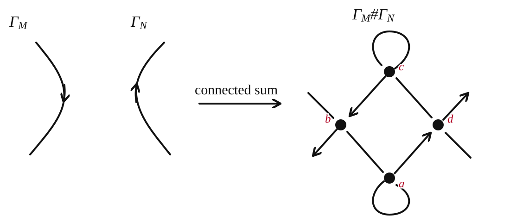

# Connected sum of closed normal o-graphs

Status: normative local-operation and real-Gauss specification

Scope: unweighted closed normal o-graphs; no edge-weight transport is specified

Terminology: [`ograph-terminology.md`](ograph-terminology.md)

## Source statement

Koda defines the connected sum of two normal o-graphs by choosing one directed
edge in each disjoint diagram, requiring the two chosen edges to run around the
boundary of a rectangle in the same direction, and replacing the resulting
two-component normal o-tangle by the four-vertex tangle in Figure 6. Theorem
1.1 states that the result represents the oriented connected sum of the two
represented closed 3-manifolds.

- Work: `[[K10]]`, Yuya Koda, *O-graphic study of closed 3-manifolds*, Hakone
  Seminar 26 (2010), 51--61.
- Construction: `[[K10#^k10-sec-0032]]`, §1.2, PDF p.3 (printed p.53).
- Defining figure and theorem: `[[K10#^k10-sec-0033]]`, Fig. 6 and Theorem 1.1,
  PDF p.4 (printed p.54).
- Local expanded drawing: [MST1 Figure 13](../../../../threads/PJ260825/sources/MST1/connected_sum.pdf).

**Evidence.**

- literature: [K10, §1.2, Fig. 6, Theorem 1.1]
- literature: [MST24, Fig. 13]

The managed Koda Work is
`w-0be57e06-c1d1-47c3-bec1-7208afa6fe59`. Its text capability is currently
`ocr-unchecked`, so the construction, figure, and theorem above were also
checked visually against the
[source PDF](../../../../references/items/article/w-0be57e06-c1d1-47c3-bec1-7208afa6fe59/sources/original/Koda2010.pdf).

## Labelled local operation

The following is MST1 Figure 13 with the four inserted vertices labelled in
the order used by the implementation:



The labels have the following fixed geometric roles.

| label | role | vertex sign |
|---|---|---:|
| `a` | lower self-loop vertex | `-1` |
| `b` | left splice vertex on the selected edge of `Γ_M` | `+1` |
| `c` | upper self-loop vertex | `-1` |
| `d` | right splice vertex on the selected edge of `Γ_N` | `+1` |

Thus the appended vertex-sign vector, in label order `(a,b,c,d)`, is

```text
(-1, +1, -1, +1).
```

## Real-Gauss splice

Let the input contain `n` real vertices and set

```text
a = n+1,  b = n+2,  c = n+3,  d = n+4.
```

Let `G_M` and `G_N` be the two selected cyclic component words after choosing
their cut seams. With `+v` denoting the over-passage and `-v` the
under-passage, the output component word is

```text
G_M, -b, -a, +a, +d, G_N, -d, -c, +c, +b.
```

The displayed word is cyclic. A cyclic rotation represents the same component
word, but changing any of the eight displayed passage signs does not implement
this local operation under the repository convention.

If an anchor occurrence is supplied for an input component, rotate that cyclic
word so the anchor is first. The cut edge is then the cyclic edge from the
predecessor of the anchor to the anchor. Without an anchor, the stored
last-to-first seam is used.

## Preconditions and postconditions

Both selected components must be closed strands of closed normal o-graphs and
must be distinct. The operation merges them into one component, adds four real
vertices, and must return a closed normal o-graph. In particular, the result
must satisfy C1, C2, and C3; for `N` output vertices the Method-B circuit count
must be `N+1`.

This specification does not define a weighted or framed connected sum. The
current `connected_sum!` operation discards existing edge weights and marks the
result unweighted. Any future weight transport requires a separate rule and
verification.
