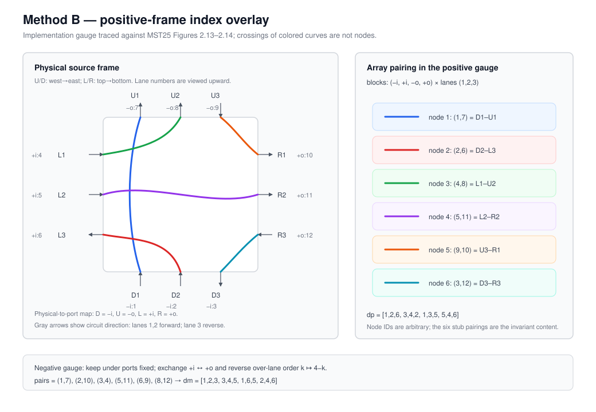

# Source-grounded o-graph move verification

Status: operational nonweighted specification; MP A1--D4 and PS-I--IV are
enabled in both directions. Their source frames and finite fixtures are
distinct from a proof of candidate-enumeration completeness.
CP is accepted only when the GKS/BP source theorem, reviewed Figure 2.2 index
map, production-SOT recipe/naturality audit, independent local-role rewrite,
and the common raw-target/outside/C1--C3/canonical/replay gates all pass.

This specification is adjacent to
[`virtual-link-moves.md`](virtual-link-moves.md). That document defines move
generation and raw rewriting; this document defines what may be accepted as a
verified Area-3 transition. Generator success and invariant equality are not
verification.

## Evidence source

The primary source is the managed Work
`w-49d1ab60-89f9-43f8-99f6-839e1ae5b0aa`, arXiv `2405.18743v3` (MST25).
Relevant exact locators are:

- `MST25.md` anchor `^mst25-fig-0102`, “Correspondence between D2 and primary
  MP move” (`submit.tex` 608–615);
- §2.4–2.5, Figures 2.13–2.16 (`submit.tex` 477–544), for Method B and PS;
- `submit.tex` 513–516: PS-I `3→2`, PS-II `3→1`, PS-III `1→2`, PS-IV `3→3`;
- `submit.tex` 574 for the strongly-regular/closedness qualification.

The Work text and figure assets are read in place. They are not copied into the
source tree, and their presence is not owner approval of a mathematical claim.

## Verified transition contract

`verify_ograph_move(source, candidate)` does not call `movable`. It must
recompute, in this order:

1. the exact catalogue row, ordered concrete vertices, and source-fragment
   occurrences frozen in `MoveCandidate`;
2. the raw rewrite by that exact candidate;
3. C1–C3 separately on source and raw target;
4. every occurrence outside the replaced fragments, the old-to-new vertex map,
   and every consecutive outside adjacency;
5. raw endpoint hashes and the exact root/relabel maps used to canonicalize
   both endpoints.

The canonical target is an endpoint identity only. Canonicalization is not part
of the move and must not erase the raw target, application locations, or
outside-region evidence.

The shared-library scope includes all sixteen MP parameters and PS parameters
`1..4`, as well as the separately specified CP and INS S patterns. The former
D2-only and PS-III-only gates were removed after checking the source frames.
`test/ograph_move_extensions.jl` finds representatives of all 32 MP
type/direction combinations on existing n≤3 closed states and checks reverse
moves and persisted-witness replay. This is a finite regression, not exhaustive
coverage of all source graphs or sites.

### D2 regression fixture

The nontrivial inverse-D2 fixture is:

```text
source GC: [-3,1,3,2,-2,-1,4,5,6,-6,-5,-4]; vertex signs: ++++++
vertices:  [1,2,3]
locations: [(1,1),(1,3),(1,5)]
raw target GC: [2,-1,1,-2,3,4,5,-5,-4,-3]; vertex signs: +++++
```

The removed vertex is old `3`; old vertices `4,5,6` map to new `3,4,5`.
The five outside adjacencies
`[4,5]`, `[5,6]`, `[6,-6]`, `[-6,-5]`, `[-5,-4]` map respectively to
`[3,4]`, `[4,5]`, `[5,-5]`, `[-5,-4]`, `[-4,-3]`.

## PS gate

MST25 Figure 2.13 replaces each true-vertex neighborhood by six local curve
arcs. Figure 2.14 numbers the three lines around an upward-viewed o-graph edge
from left to right, with circuit orientations `↑,↑,↓`. Therefore a replayable
PS witness must retain, for every Method-B segment,

```text
(real-edge occurrence, lane 1..3, directed local-node endpoints, circuit)
```

and identify the two selected source fragments as the left and right edges in
the Figure 2.15 frame. Merely being on the same aggregated disk row is
insufficient.

The managed source figures and the implementation overlay are shown together
so that this index choice can be checked without reading the arrays as magic
numbers:




The Figure 2.13 asset used for the independent trace has SHA-256
`741A4FF1C9D0DFD2189560F81F669FC4C4314270BA3AB6F6D06EDC3DB822F9F3`.
In its physical frame, the top stubs `U1,U2,U3` and bottom stubs `D1,D2,D3`
run west-to-east, while `L1,L2,L3` and `R1,R2,R3` run top-to-bottom. The six
curves are
`U1-D1`, `U2-L1`, `U3-R1`, `D2-L3`, `D3-R3`, and `L2-R2`;
unmarked crossings of curves are not nodes. With under direction `D→U` and
over direction `L→R`, the port identification is
`D=-i`, `U=-o`, `L=+i`, `R=+o`.

Fix the twelve stubs as four consecutive blocks
`(-i,+i,-o,+o)`, each with Method-B lane index `1,2,3`. The absolute local-node
numbers below are an implementation gauge. Tracing the six curves of Figure
2.13 in the positive-vertex port frame gives:

| local node | two incident `(port,lane)` stubs | array positions |
|---:|---|---|
| 1 | `(-i,1)`, `(-o,1)` | `1,7` |
| 2 | `(-i,2)`, `(+i,3)` | `2,6` |
| 3 | `(+i,1)`, `(-o,2)` | `4,8` |
| 4 | `(+i,2)`, `(+o,2)` | `5,11` |
| 5 | `(-o,3)`, `(+o,1)` | `9,10` |
| 6 | `(-i,3)`, `(+o,3)` | `3,12` |

Thus the positive table is `dp` below. In the repository's normalized negative
vertex frame, the under-passage ports are unchanged while the over-passage
direction reverses. Therefore exchange `+i` and `+o` and reverse its viewed
lane order by `k ↦ 4-k`. Applying that transformation to the six positive
pairs gives the negative pairing positions
`(1,7),(2,10),(3,4),(5,11),(6,9),(8,12)`, hence `dm`:

```text
dp = [1,2,6,3,4,2,1,3,5,5,4,6]
dm = [1,2,3,3,4,5,1,6,5,2,4,6]
```

where the four three-stub blocks are currently consumed as
`(-i,+i,-o,+o)`. The lane-3 Method-B segment is stored in the reverse circuit
direction, matching Figure 2.14's `↑,↑,↓`; this changes directed trace order but
not circuit membership.

The current template row 3 has fragments `[1,2]`, `[-2,-1]` and vertex signs
`(+,-)`. Overlaying their directions and the two signed vertex frames on Figure
2.15 identifies the row with PS-III; Figure 2.16 requires left lane 1 to connect
to right lane 2. The four frame mappings, checked against Figures 2.15--2.16,
are as follows. Fragment numbers refer to the catalogue order, whereas lanes
are intrinsic upward-viewed indices.

| parameter | paper type | left fragment | right fragment | left lane | right lane |
|---|---|---|---|---|---|
| 1 | PS-I | 1 | 2 | 3 | 2 |
| 2 | PS-II | 2 | 1 | 3 | 1 |
| 3 | PS-III | 1 | 2 | 1 | 2 |
| 4 | PS-IV | 1 | 2 | 3 | 3 |

Only PS-II swaps the two catalogue fragments. No extra `k→4-k` is applied
merely because an edge points down in the displayed figure. All four types
have positive insertion/deletion and replay fixtures.


For PS-III the left edge in Figure 2.15 points down, so its displayed strands
appear `3,2,1` from screen-left to screen-right in Figure 2.16; the intrinsic
upward-viewed lane remains lane 1. The right edge points up and is displayed
`1,2,3`. Thus the dashed connection is intrinsically left lane 1 to right lane
2, exactly as stated in `submit.tex` 510–516.

There is an important direction reversal. In inverse PS, its two-vertex RHS
is the verifier input and the zero-vertex LHS is the raw target.
MST25 states the global condition on the
diagram *before the forward move*, i.e. on that LHS. The verifier therefore
does **not** test Method B on the inverse source. For each of the two removed
RHS fragments it records the exact source positions and walks past the complete
consumed patch to the nearest outside predecessor and successor. Those signed
occurrences are transported through the old-to-new vertex map and must form an
actual consecutive edge occurrence in the raw target. Method B and the lane
condition are evaluated on that raw target; the witness fixes
`evaluated_state_side=target_raw` and its raw hash.

Forward insertion instead accepts `edge_occurrences=[(component,head),
(component,head)]`, with each fragment inserted before its specified head
occurrence. The occurrences may coincide; their fragment incidences remain
distinct. Forward Method B is evaluated on `source_raw`. For example,
`move(v,"PS";param="3",edge_occurrences=[(1,1),(1,2)])` on
`Gauss=[-1,2,-2,1]`, signs `[-1,1]`, genuinely fails application: the local
rewrite produces `Gauss=[3,4,-1,-4,-3,2,-2,1]`, signs `[-1,1,1,-1]`, whose
C3 fails. The selected PS-III lanes lie on different circuits. With the current
gate order this is reported as `target_not_closed`, not a forged-witness error.

For the stored PS-III fixture
`[-4,-3,-2,-1,1,2,3,4]` with vertex signs `(+,-,-,-)`, the concrete local
locations are `(1,5)` and `(1,3)`. The two distinct fragment incidences occupy
positions `[5,6]` and `[3,4]`. Both gap walks reach source boundary
`-3@2 → 3@7`, which transports to the same raw-target edge occurrence
`-1@2 → 1@3` (edge 3). Keeping the fragment index and source positions is
essential: the two region incidences must not be deduplicated merely because
their transported target edge ID agrees. The occurrence-preserving Method-B
trace places `(edge 3,lane 1)` and `(edge 3,lane 2)` on the same circuit. The
verifier records the complete directed circuit, not only this Boolean result.

This explicit witness requirement does not assert that closedness is
mathematically insufficient in the strongly regular setting.

The frame review is recorded in the 2026-09-08 task and the finite runtime
checks in `test/ograph_move_extensions.jl`. The MP source frames are MST25
`^mst25-fig-0097`--`^mst25-fig-0100`; suffixes 2, 3, 4 reverse respectively
fragment 3, fragment 2, and both. This does not assert a general proof from
the passing fixture set.

## CP boundary certificate and semantic gate

The CP source used here is the managed GKS26 Work
`w-804a7f2e-a181-49f6-a6f5-6ac4fddd2857`, specifically Figures 2.2 and 3.13
and the boundary-rooted E-data in `ordered_pachner_moves_v2.tex` 920--991. The
Work's bibliographic metadata is still degraded; that limits citation status
but does not change the bytes used by this finite transcription audit.

`OGraphBoundaryEData` stores one distinguished component linearly from the
right endpoint `a` to the left endpoint `b`, plus any closed components and the
vertex-sign vector. The `a,b` root is not quotiented by cyclic rotation. The
GKS26 certificate records the 14-step reduction of the CP left side and the
6-step reduction of the relabelled right side to their common terminal E-datum.
`audit_ograph_cp_boundary_certificate` checks exact source transcription,
syntax, the right-side relabelling, the two fixed boundary roots, and equality
of the terminal E-data. It intentionally returns
`semantic_moves_verified=false`: the individual arrows have not yet been
replayed by source-grounded MP/PS/BMP/BPS verifiers.

Steps 7--13 on the left and 1--5 on the right contain two additional closed
components besides the `a`--`b` component. They are therefore a DB-external
boundary certificate, not a path through the current one-circuit closed-normal
state table. Increasing only the vertex cutoff does not remove this category
boundary.

The paper-frame CP endpoint E-data agree with the frozen runtime catalogue only
after the componentwise algebraic transformation
`N(G, eps) = (-G, -eps)`. `ograph_cp_catalogue_source_gate` checks that finite
array correspondence and reports `geometric_authority_verified=false` and
`certifiable=false`. Finite equality of arrays is not a proof that `N`
transports the paper CP move into the runtime o-graph convention; in particular,
it must not be described as a geometric mirror or identified with the INS
`S`-move without a separate derivation.

### Recipe-naturality lemma

The remaining paper-frame change is not a mirror convention. It is the
involution

```text
N(G, eps) = (-G, -eps),       N^2 = id,
```

applied to the whole o-graph, with boundary roots `a,b` held fixed. The following
derivation is the semantic gate.

1. The production `_disk_node_dictionary()` is the single source of truth used
   by `disk_table`; the verifier derives, rather than copies, its twelve local
   slots grouped into the four repository faces
   repository faces

   ```text
   T+ = ((1,2,6), (3,4,2), (1,3,5), (5,4,6))
   T- = ((1,2,3), (3,4,5), (1,6,5), (2,4,6)).
   ```

   Every germ label occurs in exactly two triples. The complementary pair of
   face indices therefore identifies one of the six tetrahedron edges. This is
   a gauge: renaming all six germs does not change the induced face gluing.

2. For an oriented Gauss-code edge, the production slots select outgoing face
   `2 + (tail>0)` and incoming face `(head>0)`. Zipping the two three-entry face
   triples determines a unique permutation `sigma` of tetrahedron vertices.
   Under the reviewed Figure 2.2 maps

   ```text
   rho+ = (2,0,3,1),    rho- = (3,1,2,0),
   ```

   this `sigma` equals the unique order-preserving face identification required
   by GKS26 `^anonnd-blk-0077`. The audit exhausts the sixteen choices of the two
   vertex signs and the two endpoint passage signs. Thus the implementation
   recipe is not being validated against a second copy of its own CP table: its
   induced face maps are compared to the source's ordered-tetrahedron rule.

3. Negating a passage sign sends its incident face through
   `p=(0 1)(2 3)`. For every vertex sign and face,

   ```text
   mu(T_eps(f,k)) = T_-eps(p(f),tau(k)),
   mu=(1 4)(2 3)(5 6),    tau=(1 2).
   ```

   The same lane permutation `tau` occurs at both ends of every o-graph edge,
   so it cancels in the zipped face pairing. Equivalently, the sixteen cases
   satisfy `sigma_N p = p sigma`. Hence the copy of `p` on every tetrahedron
   descends to a global simplicial isomorphism between the underlying
   triangulations of `Gamma` and `N(Gamma)`.

4. GKS26 `^anonnd-blk-0032` defines tetrahedron type by compatibility of the
   vertex ordering with the manifold orientation, while Figure 2.2 assigns
   crossing signs `+ -> type -` and `- -> type +`. The map `p` is even, but `N`
   reverses every crossing sign and hence every tetrahedron type. The global
   simplicial isomorphism is therefore orientation-reversing:

   ```text
   M(N(Gamma)) = -M(Gamma).
   ```

   For a closed normal o-graph the ideal triangulation is the closed manifold
   with one ball removed and standard sutured `S^2` boundary. The induced map
   restricts to a homeomorphism of that boundary sphere, hence extends over the
   filling ball; the orientation-reversal conclusion is therefore a statement
   about the filled closed manifold used by the database.

5. BP97 Theorem 6.3.1 and fact II (`^bp97-blk-0232`, with the proof conclusion
   at `^bp97-blk-0235`) state directly that two closed normal o-graphs related
   by combinatorial Pontryagin move define the same oriented manifold. GKS26
   `^anonnd-blk-0116` and `^anonnd-blk-0124` provide the matching modern
   formulation. For an arbitrary runtime context `Gamma` containing the runtime
   left pattern, apply `N` globally. The local pattern becomes the source CP
   left E-datum, with the same `a,b` boundary roots. Apply source CP, then apply
   `N` again. Because `N` is global and involutive, the result is the runtime
   right pattern in the unchanged runtime context. Both runtime endpoints
   represent the orientation reversal of the same source manifold.

`ograph_cp_negation_recipe_audit` checks Steps 1--4 finitely: eight local-frame
identities, sixteen face-pairing naturality identities, and all sixteen
comparisons with the GKS order-preserving face map. Step 5 is the source theorem
plus the displayed involution argument. This proves CP endpoint preservation
without identifying `N` with the INS `S`-move and without requiring the
twenty-step factorization to stay inside the one-circuit database category.
The present mathematical status is `proved/agent`: the load-bearing source
statements have exact locators and the finite implementation obligations pass,
but the argument has not been promoted to `proved/owner-checked`.

The source-to-repository face correspondence is fixed visibly in the following
overlay. Black pixels are a crop of managed GKS26 Figure 2.2; blue face/port
labels are repository annotations. In repository order
`(f0,f1,f2,f3)=(-i,+i,-o,+o)`, the source-printed omitted tetrahedron vertices
are exactly the two `rho` vectors above.


The indexed overlay has an independent visual PASS recorded in
`threads/PJ260830/data/260907_rq6_astra_visual_review.json`: all eight
face/port-to-source-triple assignments, both `rho` vectors, the displayed
conjugacy equation, and non-occlusion were checked. Accordingly the audit
reports `gks_figure_2_2_index_overlay_reviewed=true`. That review covers the
source face/port numbering only; it does not by itself check the ordered
three-lane germ recipe, all sixteen gluing cases, or global CP naturality.
The lane/gluing part is instead discharged by deriving the triples from the
production SOT and comparing every induced face map with GKS's unique
order-preserving map. Consequently the recipe audit reports
`recipe_source_authority_verified=true` and `certifiable=true`. This is the CP
semantic-authority gate; the visual PASS is not being inflated into a lane or
global proof. The twenty-step factorization's still-unverified individual
arrows and INS Figure 34 panel C are separate questions and do not weaken this
direct CP proof.

`audit_ograph_cp_candidate` applies an independent role-wise CP rule and compares
its raw target with the production catalogue rewrite. For the inverse move it
retains local roles 1--3 and removes local roles 4--5, irrespective of the
numeric magnitudes of the selected global vertex labels. This catches the
historical implementation rule that removed the two numerically largest labels.
The audit is certifying only when that independent target agrees with the
production raw target and the recipe-naturality gate passes. The ordinary
verifier then continues through target C1--C3, explicit outside occurrences,
canonical target, persistence, and replay; CP does not bypass the common
verification path.

## INS S-move is an auxiliary relation, not the CP catalogue row

The managed [INS24 Work](../../../../references/items/article/w-48ec88c2-87f9-4f52-bd67-a563d1bf3d32/INS24.md),
§4 Figure 16 (`^ins24-blk-0009`), calls its local surgery move the `S`-move and
says that it is *essentially equivalent* to the BP combinatorial Pontryagin
move. This prose does not identify their local arrays. In the repository
crossing convention, the boundary-rooted Figure 16 candidate is

```text
left:  []
right: [1,2,-3,-4,4,3,-2,-1]; vertex signs: [-,-,-,-]
```

with `IN` at the left endpoint and `OUT` at the right endpoint. Thus INS `S` is
a `0 <-> 4` pattern, while the BP/GKS CP row is `3 <-> 5`. They must not share
a `MovePattern` merely because both remove the dependence on a combing.


Appendix B, Lemma B.2 and Figures 33--34 (`^ins24-blk-0020` and
`^ins24-blk-0021`) establish a different precise claim:
the surgery move of Ishii (1992) is realizable by one INS `S`-move together
with finitely many INS `I`-moves, `R2`-moves, and virtual Reidemeister moves.
The printed endpoints of that older surgery move transcribe to the candidates

```text
left:  [1,-2,-3,3,4,2,-4,-1]; vertex signs: [-,-,-,+]
right: [1,2,-2,-1];             vertex signs: [+,-]
```

so this relation is `4 <-> 2`, again not a direct CP row. Figure 34 contains
eight diagrams and seven arrow groups, with exactly one `S` arrow; it is a
factorization witness, not permission to replace the endpoints by a single
runtime move. In the boundary-rooted partial transcription, the three R2
stages already have unique outside-label maps: the first adds intermediate
roles `3,4`, the pre-`S` cleanup removes roles `5,6`, and the final stage adds
the two crossings of the old-surgery right side. The intervening `I`/
`(R2,VR2)` panels are not yet a semantic certificate. In particular, Figure 34
panel C remains unresolved: its short central printed fragments cannot safely
be inferred from the desired B-to-D relation. Flattened handwritten annotations
on the archival PDF are not used as source evidence.


BP97 Theorem 6.3.1 gives the complementary bridge: Figure 1.6 is the
combinatorial Pontryagin move, its endpoints define the same oriented manifold,
and §6.3 connects the flow-section o-graphs of Figures 6.3 and 6.8 to Figure 1.6
by planar isotopy and Reidemeister-type moves. A source-grounded LA1 certificate
therefore needs two explicit boundary-preserving comparison paths:

1. BP Figure 1.6 to its §6.3 flow-section representatives; and
2. the Ishii (1992) surgery endpoints through INS Figure 34 to INS Figure 16.

The remaining identification between those two flow-spine presentations must
be displayed with its local indices and auxiliary moves. Until that comparison
is supplied, `S`, old surgery, and CP remain three typed move names connected by
the proved relations above, not aliases. The present verifier accepts the
independently transcribed INS S pattern in both directions, with the common
source/raw-target/outside/C1--C3/canonical/replay gates. This does not certify
the missing comparison paths. Insertion selects one edge occurrence; deletion
selects four ordered vertex roles. Manifold profile v2 includes S; combed
profiles do not.

## Persistence and replay

`ograph_move_witness_data` is the canonical JSON-like surface.
`ograph_move_witness_from_data` requires the exact schema and field set and
rejects type drift. `replay_ograph_move` reconstructs the source and catalogue
candidate, reruns the semantic verifier, and compares every regenerated witness
field. A DB must call this replay gate; a stored `valid` flag, matching
invariants, or the mere presence of a witness object is not acceptance.

Version `/3` retains exact replay of `/2` witnesses. For legacy MP D2 the
current source-role rewrite must first give the recorded canonical target;
then the old sorted-label patch numbering is reproduced to compare every
historical raw field. Old evidence is not rewritten. Profile v2 records a
type/direction capability snapshot separately from calculus completeness.
The witness returned by replay retains the historical verifier version too,
so serializing and replaying that returned witness remains valid.
