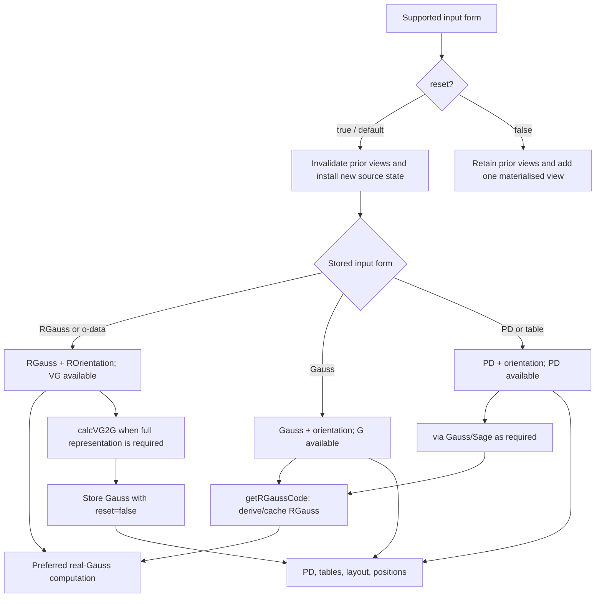

# VirtualLink multi-representation data-model rationale

Status: design rationale and provisional Julia target; not yet a normative API specification<br>
Scope: mathematical state, representation conversion, caching, and mutation semantics of MATLAB and Julia `VirtualLink`<br>
Audience: maintainers, port authors, reviewers, and computation authors<br>
Owner context: 東京科学大学 情報理工学院 数理・計算科学系 鈴木咲衣研究室<br>
Source inspected: `Manifold/VirtualLink/VirtualLink.m` and the current Julia migration worktree, 2026-08-26

## 1. Thesis

A `VirtualLink` should not be forced into one universal stored representation.
Gauss, real Gauss, PD, table, o-data, and text inputs are useful at different
boundaries and may carry source-specific labels or provenance. The design should
therefore preserve the received input, prefer real Gauss data for mathematical
computation, and derive other representations only when required.

The core policy is:

> Preserve the supplied presentation as input authority; use real Gauss plus
> crossing orientation as the preferred computational view; treat full Gauss,
> PD, tables, layout, and positions as reproducible views or caches.

This separates two meanings of “source of truth”:

- **input authority** — the exact representation and payload supplied;
- **calculation authority** — the representation used as the common interface by
  algorithms.

Real Gauss is the preferred computational view. It is not automatically the
original input and must not erase another supplied representation.

## 2. Roles of stored data

| Role | Meaning | Examples |
|---|---|---|
| Ingress source record | Exact received representation and payload | Gauss, RGauss, PD, o-data, table identity, text input |
| Preferred computational view | Common representation requested by moves, weights, and invariants | RGauss + ROrientation |
| Derived combinatorial view | Recomputable conversion or table | Gauss, PD, RPD, crossing/edge/strand tables |
| Derived geometric view | Recomputable drawing state | planarisation, bending numbers, positions, layout, SVG |
| Evidence/replay data | Captured external output used for comparison or replay | MATLAB `REdgeTable.Position`, exported JSON, figures |

Weights are mathematical annotations on real arcs. They may be part of a
weighted o-graph computation without becoming the topological identity of the
underlying unweighted virtual link.

### 2.1 Open strands and cut markers

The Julia `VirtualLink` representation records an open strand with one trailing
`0` in its raw Gauss component. The marker is metadata, not a crossing: a zero
is valid only as the final entry of a component, and `strand_cuts(link)` derives
one actual `Bool` per strand from that marker. `gauss_code` and
`real_gauss_code` preserve the marker; virtual crossing visits remain in the
raw code and are omitted from the real code, while the trailing marker remains.

For a cut strand with (m) real crossing visits, `real_edge_table` exposes
(m+1) directed arcs, including the distinct boundary edges `(0, first)` and
`(last, 0)`. A strand with no real visits still has the crossing-free boundary
arc `(0, 0)`. These boundary IDs are representation-local and must not be
identified with closed PD edge labels.

`set_cuts!(link, flags)` requires one actual `Bool` per stored strand. On an
unweighted link it adds or removes only the trailing markers and resizes the
derived zero weight vectors by prefix. Changing the cut status of a weighted
link is rejected; callers must clear or rebuild the weights and then assign the
explicit (m+1) open-arc vectors. This prevents a closure weight from being
silently copied to both boundary edges.

`pd_code` is a full/raw traversal view: its edge IDs include virtual visits and
open boundary IDs, so they are not the IDs of `real_edge_table`. PD decoding
uses the supplied crossing orientation to recover directed strands; an open
boundary is preserved as a trailing marker when the conversion is defined.

A mathematical virtual link is not identified by a unique Gauss or PD normal
form in the current implementation. “Source” therefore means an adopted
presentation, not a canonical representative of an equivalence class.

## 3. Current MATLAB model

### 3.1 Broad ingress

MATLAB `VirtualLink.setData` accepts several forms. Native Gauss, RGauss, and PD
inputs are retained in their corresponding fields; adapter inputs such as
`odata`, `table`, and `ostring` are first routed to a supported working form.

| Input argument | Initial stored form | Initial route/cache state |
|---|---|---|
| `GaussCode` | `GaussCode`, `orientation` | `G=true`, `virtualFlag=false` |
| `RGaussCode` | `RGaussCode`, `ROrientation` | `VG=true`, `virtualFlag=true` |
| `PDCode` | `PDCode`, `orientation` | `PD=true`, `virtualFlag=false` |
| `odata` | routed to `RGaussCode`; optional weights are stored separately | real-Gauss route |
| `table` | converted through Sage to PD, then stored as `PDCode` | PD route |
| `ostring` | parsed and routed to real-Gauss input | real-Gauss route |

This is intentionally not destructive normalization. A caller can supply a
presentation in the form natural to its source boundary.

### 3.2 Two kinds of state change

`setData` defaults to `reset=true`. This establishes a new mathematical-state
checkpoint:

```text
setData(input)  ≡  setData(input, reset=true)
    → clear representation/table/position validity flags
    → clear the expected Sage link state
    → install the new supplied representation
```

In ordinary use this is mutation of the mathematical object represented by the
MATLAB handle.

`reset=false` has a different meaning:

```text
setData(derived_view, reset=false)
    → retain previously available representations
    → add or refresh one derived representation
```

`calcVG2G` uses this second path. It reads retained RGauss data, inserts virtual
crossings for a visualisable full Gauss representation, and stores the result
without clearing the RGauss availability flag.

### 3.3 Cache guards

`formatFlag` is a ledger of available or valid representations and tables:

```text
G, PD, VG, RPD, TC, TRC, TE, TRE, TS, HM, RHM, pos
```

A getter or calculator checks its corresponding flag:

```text
flag true  → return/reuse the stored value
flag false → calculate the view, store it, and mark it available
```

Thus the flag blocks redundant recomputation. It is an availability/cache flag,
not necessarily an input-provenance record: a flag may become true either
because that form was supplied or because a getter derived it later.

### 3.4 Active route

`virtualFlag` selects whether generic access prefers the real-Gauss or full-Gauss
route. For example, `getGC` delegates to `getRGaussCode` when the flag is true
and to `getGaussCode` otherwise.

`virtualFlag` is therefore an active-route flag, not a sufficient record of the
original input kind. In the current implementation, materialising `GaussCode`
through `calcVG2G` calls the `GaussCode` branch of `setData(reset=false, ...)`,
which sets `virtualFlag=false`. A cache fill can consequently change later
routing even though the retained RGauss data remains available. This is a
current coupling, not a required part of the data-model rationale.

### 3.5 MATLAB state machine



## 4. What is good about this design

### PR1 — Preserve source information

An eager conversion to one representation can erase input labels, presentation
choices, or comparison identity. Retaining the supplied form supports
reproducibility, debugging, and MATLAB/Sage/Julia parity work.

### PR2 — Use RGauss as a computational interface

Real Gauss data describes the real-crossing traversal without making inserted
virtual crossings part of the mathematical calculation boundary. It is a
natural interface for moves, real-edge weights, and invariants.

### PR3 — Materialise visual and tabular views lazily

Planarisation, PD construction, tables, and positions need not run for every
calculation. Lazy materialisation avoids unnecessary Sage or layout work and
allows several representations to coexist.

### PR4 — Distinguish topology replacement from cache filling

The `reset=true` versus `reset=false` distinction captures an important semantic
boundary: replace the represented object versus add another view of the same
object.

## 5. Current implementation risks

### IS1 — Source, availability, and route are not fully separated

The implementation has three distinct questions:

```text
What was supplied?       source/provenance
What is available now?   cache validity
What should be used now? active route
```

`formatFlag` and `virtualFlag` answer parts of all three. After lazy conversion,
they cannot by themselves reconstruct the original input provenance.

### IS2 — Cache invalidation is distributed

Representation dependencies are implicit in setter and calculator methods.
Direct property mutation or an incomplete `reset=false` path can leave tables or
positions inconsistent with the mathematical state.

### IS3 — Read operations may have hidden effects

Getters can invoke conversion, Sage, cache writes, and route changes. A call that
looks observational may therefore change subsequent behavior.

### IS4 — Representation-local identity is unstable

PD edge labels, table rows, and coordinates are not global mathematical IDs.
Data attached to them must use a documented real-arc traversal or explicit key,
and must be remapped after a representation-changing conversion.

## 6. Julia target principle

Julia should preserve the MATLAB design intent without copying its handle-state
mechanism literally:

> The mathematical value is immutable; representation conversion is pure;
> optional memoisation is mutable but semantically invisible.

The target split is:

```text
immutable VirtualLink value
    = retained source presentation
    + mathematical annotations

pure representation functions
    = rgauss(link), gauss(link), pd_code(link), real_edges(link), ...

optional mutable workspace/cache
    = previously computed views for one exact immutable value
```

### 6.1 Represent ingress forms explicitly

A provisional shape is:

```julia
abstract type LinkSource end

struct RGaussSource <: LinkSource
    components::Vector{Vector{Int}}
    orientation::Vector{Int}
end

struct GaussSource <: LinkSource
    components::Vector{Vector{Int}}
    orientation::Vector{Int}
end

struct PDSource <: LinkSource
    code::Matrix{Int}
    orientation::Vector{Int}
end

struct VirtualLink{S<:LinkSource,W}
    source::S
    weights::W
    strand_types::Vector{Char}
end
```

The exact field containers remain provisional. Julia `struct` is only shallowly
immutable when it contains mutable arrays; constructors must take ownership by
copying or otherwise prevent external mutation, and public APIs must not expose
unguarded mutable internals.

The source type records the supplied representation directly. A cache flag is
not needed to infer provenance.

### 6.2 Use dispatch instead of an active-route flag

```julia
rgauss(link::VirtualLink{<:RGaussSource}) = link.source
rgauss(link::VirtualLink{<:GaussSource}) = remove_virtual_crossings(link.source)
rgauss(link::VirtualLink{<:PDSource}) = pd_to_rgauss(link.source)
```

Algorithms request the representation they require explicitly. Materialising a
Gauss view must not change what later generic operations mean.

### 6.3 Return new values for mathematical transformations

```julia
mirror_manifold(link) -> new_link
cyclic_shift(link, strand, amount) -> new_link
mp_move(link, parameter, vertices) -> new_link
connected_sum(left, right) -> new_link
```

A transformation creates a new mathematical value and leaves the original
available for comparison or reuse. Mutating `!` APIs, if retained, should belong
to a builder or interactive workspace rather than define the core value
semantics.

### 6.4 Keep memoisation separate

Begin with uncached pure conversions unless profiling establishes a material
cost. When repeated interactive work requires caching, use a separate typed
cache associated with one exact immutable value:

```julia
mutable struct LinkCache
    rgauss::Union{Nothing,RGaussData}
    gauss::Union{Nothing,GaussData}
    pd::Union{Nothing,PDData}
    real_edges::Union{Nothing,Vector{RealEdge}}
end

struct LinkWorkspace{L}
    value::L
    cache::LinkCache
end
```

Creating a transformed `VirtualLink` creates a new workspace or empty cache.
There is no invalidation graph across mathematical mutations because an old
cache remains attached only to the old value.

An internal mutable cache inside an otherwise immutable `VirtualLink` is also
possible, but then equality, hashing, serialization, and mathematical identity
must ignore the cache, and concurrent access requires explicit synchronization.
A separate workspace is the clearer default.

## 7. Required semantic invariants

Any Julia design derived from this rationale should preserve the following:

1. **Input retention.** The supplied representation and its provenance remain
   recoverable without inferring them from a derived-view flag.
2. **Preferred computation.** Algorithms may use RGauss as their common view
   without rewriting the retained source.
3. **Pure observation.** Requesting another representation does not change the
   mathematical value or later dispatch meaning.
4. **Explicit transformation.** A mathematical move returns a new value unless a
   clearly named builder/workspace mutation API is requested.
5. **Disposable cache.** Deleting every derived cache changes performance only,
   not results or identity.
6. **No unstable external identity.** PD labels, table rows, and positions are
   local views unless a separate stable-key contract is defined.
7. **Reproducible conversion.** Derived representations can be rebuilt from the
   retained source plus explicit algorithm/version parameters.
8. **Separated evidence.** Replay coordinates and rendered figures do not become
   mathematical source data merely because they are stored.

## 8. Migration direction

The current Julia `mutable struct VirtualLink` and `set_data!` reproduce part of
the MATLAB surface but collapse source provenance, active representation, and
working state into one mutable object. A future refactor should proceed in this
order:

1. add explicit source-representation types and preserve received payloads;
2. implement pure `rgauss`, `gauss`, and PD conversion functions with tests;
3. make mathematical transformations return new values;
4. move optional memoisation into a separate workspace/cache;
5. port tables, geometry, and replay paths as derived views;
6. retire `real_only` and mutation-based route selection only after equivalent
   behavior and source retention are verified.

This refactor must not be justified as “making RGauss the sole canonical data.”
Its purpose is to separate input authority, calculation authority, and derived
state while retaining broad input support.

## 9. Non-goals

This document does not yet specify:

- a canonical normal form for virtual-link equivalence classes;
- equality or hashing across different source presentations;
- a stable global edge/crossing identity scheme;
- the final Julia public API or exact container types;
- cache eviction, serialization, or thread-safety details;
- performance acceptance thresholds;
- changes to MATLAB behavior.

Those require separate decisions and executable tests.

## 10. Source traceability

| Concern | Current source |
|---|---|
| MATLAB state fields and flags | `Manifold/VirtualLink/VirtualLink.m`, properties and `formatFlag0` |
| Input handling and reset semantics | `VirtualLink.setData` |
| Active representation selection | `VirtualLink.getGC` and `virtualFlag` |
| Real-Gauss derivation/cache | `VirtualLink.getRGaussCode` |
| Full-Gauss materialisation | `VirtualLink.calcVG2G` and `vg2g` |
| PD derivation | `VirtualLink.getPDCode`, `getRPDCode` |
| Weights and real-edge ordering | `VirtualLink.setWeight`, `calcREdgeTable` |
| MATLAB plotting/cache behavior | `docs/specs/virtual-link-plot.md`, §§18–24 |
| Current Julia state model | `src/virtual_link.jl` |

## 11. Decision status

Accepted as design direction in the owner conversation:

- broad ingress support is intentional;
- received input should be retained;
- RGauss is the preferred computational view, not the sole input authority;
- flags currently guard cached recomputation;
- default MATLAB `setData` is mathematical-object mutation;
- Julia should separate immutable mathematical values from optional mutable
  memoisation.

The exact Julia types, equality semantics, and cache API remain open.
