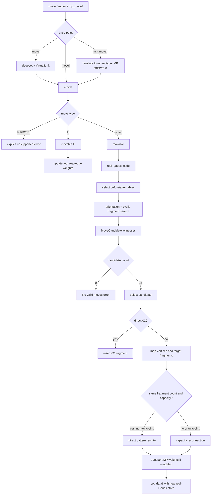

# VirtualLink move subsystem — design rationale and specification

Status: normative specification for the current Julia move subsystem<br>
Scope: `MovePattern`, `MoveCandidate`, `make_move_data`, `movable`, `move`, `move!`, and `mp_move!`<br>
Audience: maintainers, port authors, reviewers, and computation authors<br>
Owner context: 東京科学大学 情報理工学院 数理・計算科学系 鈴木咲衣研究室<br>
Source basis: MATLAB `VirtualLink` move implementation and the Julia worktree, 2026-08-26<br>
Related specification: [`virtual-link-data-model.md`](virtual-link-data-model.md)

## 1. Purpose

This document defines the required structure and behavior of the Julia
`VirtualLink` move subsystem.

The subsystem is not a collection of independent functions for MP, PS, CP, and
other moves. It is one data-driven pipeline:

```text
move catalogue
    → applicability search
    → frozen candidate witness
    → generic fragment rewrite/reconnection
    → vertex and weight transport
    → one committed VirtualLink state
```

The central implementation requirement is:

> A move family MUST be represented by move data and executed by the common
> search and rewrite pipeline. A family-specific function MUST NOT duplicate
> Gauss matching, cyclic splicing, vertex relabelling, or capacity
> reconnection.

`mp_move!` is therefore only a compatibility entry point. It is not an
independent MP implementation.

## 2. Design rationale

### 2.1 Separate mathematical data from execution

A move template describes a local replacement. It does not decide where the
replacement occurs in a concrete link.

The catalogue MUST contain only reusable local data:

- local Gauss fragments;
- local crossing orientations;
- local vertex count;
- fragment boundary/capacity labels;
- optional edge-weight rules;
- a move parameter such as `A2`, `C3`, `E1`, or `inv`.

Applicability search maps that local data to one concrete `VirtualLink`.
Execution then consumes the resulting witness.

This separation is inherited from MATLAB's
`makeMovesData → movable → move → convertGaussCode` structure. Julia preserves
that structure without reproducing MAT-file side effects or accidental MATLAB
stub behavior.

### 2.2 Catalogue coverage is not execution coverage

The existence of `MP-L` and `MP-R` rows for all A1–D4 labels proves only that
the local move data exists.

It does not prove that:

- the move can be found in every cyclic position;
- inverse execution works;
- component split/merge works;
- edge weights are transported;
- an invariant is preserved;
- every paper-level decomposition is executable.

Documentation and tests MUST distinguish these claims.

### 2.3 Search before mutation

`movable` is the applicability layer. It MUST be observational: it may allocate
candidate data, but it MUST NOT mutate the source `VirtualLink`.

`move!` MUST select a candidate before changing mathematical state. Search and
execution MUST NOT independently choose different permutations or fragment
occurrences.

For that reason `MoveCandidate` freezes:

- selected vertex order;
- move direction;
- source and target templates;
- one concrete location for every source fragment.

### 2.4 Use real-Gauss data as the calculation view

Move matching operates on real crossings. `movable` and `move!` MUST request
`real_gauss_code(v)` rather than search inserted virtual crossings in a full
plotting Gauss code.

This follows the authority split in
[`virtual-link-data-model.md`](virtual-link-data-model.md): received input is
input authority, while real Gauss plus real orientation is the preferred
calculation view.

A move replaces mathematical state. It may therefore install a new real-Gauss
presentation. It MUST NOT treat a full-Gauss drawing cache as move data.

### 2.5 Cyclic words are intrinsically cyclic

A fragment that crosses the stored end/start boundary of a closed Gauss
component is not exceptional or invalid.

Applicability search MUST match fragments cyclically. Execution MUST either:

- perform a direct rewrite when all matched intervals are linear in the stored
  word; or
- enter capacity-based reconnection when a fragment wraps or the move changes
  fragment/component structure.

It MUST NOT reject a mathematically valid occurrence merely because its stored
position wraps.

### 2.6 Mutation must be explicit

The public API provides both forms:

```text
move!  mutates the supplied VirtualLink
move   deep-copies first and returns a new VirtualLink
```

This keeps MATLAB handle-style workflows available while providing a pure-value
boundary for Julia callers.

Long-term immutable `VirtualLink` work may replace the internal implementation,
but it MUST preserve this observable distinction.

### 2.7 Preserve source limitations explicitly

MATLAB is a partial reference implementation, not a complete move-calculus
oracle.

Julia MUST NOT imply support merely because MATLAB has a switch branch or a MAT
file. Unsupported behavior MUST reject explicitly. In particular, the current
contract does not silently invent:

- R1/R2/R3 execution;
- weighted CP, BMP, B02, or INS S transport;
- a mod-2 spin calculus or a framed equivalence-class classifier;
- certificates outside the explicit [Area-3 verifier contract](ograph-move-verifier.md).

The Area-3 layer now checks PS-I--IV Method-B conditions and supports
occurrence-selected insertion. These are explicit additions, not inferred
from the legacy MATLAB dispatch table.

## 3. Normative language

The keywords **MUST**, **MUST NOT**, **SHOULD**, **SHOULD NOT**, and **MAY** are
normative.

- **MUST / MUST NOT**: required for conformance.
- **SHOULD / SHOULD NOT**: expected unless a documented reason justifies a
  deviation.
- **MAY**: optional behavior.

## 4. Public API

The exported surface is:

```julia
make_move_data() -> Dict{String,Vector{MovePattern}}

movable(
    v::VirtualLink,
    type;
    param=nothing,
    vertices=Int[],
    edges=nothing,
    strict=false,
) -> Vector{MoveCandidate}

movable(v::VirtualLink, type, arg::NamedTuple) -> Vector{MoveCandidate}

move!(
    v::VirtualLink,
    type;
    param=nothing,
    vertices=Int[],
    edges=nothing,
    strict=true,
) -> VirtualLink

move!(v::VirtualLink, type, arg::NamedTuple) -> VirtualLink

move(v::VirtualLink, type; kwargs...) -> VirtualLink
move(v::VirtualLink, type, arg::NamedTuple) -> VirtualLink

mp_move!(
    v::VirtualLink,
    parameter::AbstractString,
    vertices,
) -> VirtualLink
```

### 4.1 NamedTuple argument aliases

For MATLAB-style argument records, the following names are equivalent:

| Meaning | Long form | MATLAB-compatible alias |
|---|---|---|
| Move parameter | `param` | `p` |
| Selected vertices | `vertices` | `v` |
| Selected edges | `edges` | `e` |
| Ordered matching | `strict` | `strict` |

Example:

```julia
move!(link, "MP", (param="A2", v=[2,1]))
```

### 4.2 Type normalization

Move type names are normalized with `uppercase(String(type))`.

The following canonical names are reserved:

```text
R1, R2, R3, MP, PS, CP, 02, H, BMP, B02
```

Move parameters remain case-sensitive catalogue identifiers.

### 4.3 Strictness

`movable` defaults to `strict=false` and MAY search every permutation of the
selected vertices.

`move!` defaults to `strict=true`. A mutating call therefore preserves the
vertex order explicitly supplied by the caller unless the caller requests a
non-strict search.

If a non-strict `move!` call produces several candidates, the current
implementation warns and applies the first candidate. Callers requiring a
specific occurrence SHOULD call `movable` first and inspect the witnesses.

## 5. Move data contract

### 5.1 `MovePattern`

```julia
struct MovePattern
    parameter::String
    gauss::Vector{Vector{Int}}
    orientation::Vector{Int}
    capacity::Vector{Int}
    gauss_first::Vector{Int}
    gauss_last::Vector{Int}
    vertex_count::Int
    weights::Vector{Vector{Float64}}
end
```

| Field | Contract |
|---|---|
| `parameter` | Move-family-local identifier. |
| `gauss` | Ordered local Gauss fragments using local vertex labels `1:vertex_count`. |
| `orientation` | One crossing orientation per local vertex. |
| `capacity` | One boundary/reconnection label per fragment. |
| `gauss_first` | First signed visit of each fragment; `0` for an empty fragment. |
| `gauss_last` | Last signed visit of each fragment; `0` for an empty fragment. |
| `vertex_count` | Maximum absolute local label, or `0` for an empty pattern. |
| `weights` | One local edge-weight rule per fragment. |

The constructor MUST derive missing metadata in the same role as MATLAB
`makeMovesData.m/modify`:

- default capacity is `1:length(gauss)`;
- default weights are zero vectors of length `length(fragment)+1`;
- metadata vectors have one entry per Gauss fragment.

A `NaN` weight rule means that weighted transport is intentionally unspecified.
Execution MUST reject that weighted move rather than guess a rule.

### 5.2 Weight-rule indexing

For a fragment with `n` signed visits, its weight rule has `n+1` entries:

```text
boundary before first visit,
internal edges between visits,
boundary after last visit
```

During replacement:

- the incoming boundary weight changes by
  `after.weights[1] - before.weights[1]`;
- internal target edges use the target rule;
- the outgoing boundary weight changes by
  `after.weights[end] - before.weights[end]`.

### 5.3 Catalogue keys

`make_move_data()` MUST return these keys:

```text
MP-L, MP-R,
02-L, 02-R,
CP-L, CP-R,
PS-L, PS-R,
BMP-L, BMP-R,
B02-L, B02-R
```

`H` is an edge-weight operation and has no local Gauss replacement table.
R1/R2/R3 have no executable catalogue in the current contract.

### 5.4 MP catalogue

`MP-L` and `MP-R` MUST each contain all 16 parameters:

```text
A1–A4, B1–B4, C1–C4, D1–D4
```

The numbered variants are generated from the A/B/C/D base rows by the same
strand-reversal flags as MATLAB:

```text
000, 001, 010, 011
```

When reversal affects only one visit of a virtual crossing, its two signed
visits MUST be swapped while its orientation remains zero.

### 5.5 Other catalogue requirements

- `PS-R` MUST contain parameters `1`, `2`, `3`, and `4` in MATLAB order.
- `BMP-L` and `BMP-R` MUST contain `E1`, `F1`, `E2`, and `F2`.
- `B02-R` MUST contain parameters `1` and `2`.
- The source and target rows for a parameter MUST agree on the meaning of local
  labels even when their fragment counts differ.

## 6. Candidate contract

### 6.1 `MoveCandidate`

```julia
struct MoveCandidate
    type::String
    parameter::String
    vertices::Vector{Int}
    edges::Vector{NTuple{2,Int}}
    direction::Symbol
    before::Union{Nothing,MovePattern}
    after::Union{Nothing,MovePattern}
    locations::Vector{Tuple{Int,Int}}
end
```

| Field | Contract |
|---|---|
| `type` | Canonical move type. |
| `parameter` | Selected catalogue parameter. |
| `vertices` | Concrete ordered vertex map for local labels. |
| `edges` | Normalized concrete edge arguments. |
| `direction` | `:forward`, `:inverse`, or `:weight`. |
| `before` | Source template, or `nothing` for a non-template operation. |
| `after` | Target template, or `nothing` for a non-template operation. |
| `locations` | One `(component,start)` pair per source Gauss fragment. |

A candidate is an applicability witness, not merely a user request. Every
location MUST refer to the exact real-Gauss view used during search.

### 6.2 Vertex arguments

For pattern-driven moves, selected vertices MUST be positive real-vertex IDs in
`1:length(real_orientation)`.

The exception is direct `02`, whose two values are signed adjacent visits in a
real Gauss component.

### 6.3 Edge arguments

Edges normalize to ordered two-integer tuples. A matrix is interpreted row by
row.

The existence of normalized edge data does not imply that every move family has
an edge-selected execution branch.

## 7. Direction selection

The number of selected vertices chooses the source and target side:

| Move | Selected vertices | Source | Target | Direction |
|---|---:|---|---|---|
| MP | 2 | `MP-L` | `MP-R` | `:forward` |
| MP | 3 | `MP-R` | `MP-L` | `:inverse` |
| CP | 3 | `CP-L` | `CP-R` | `:forward` |
| CP | 5 | `CP-R` | `CP-L` | `:inverse` |
| PS | 2 | `PS-R` | `PS-L` | `:inverse` |
| PS | none; two edge occurrences | `PS-L` | `PS-R` | `:forward` |
| S | none; one edge occurrence | `S-L` | `S-R` | `:forward` |
| S | 4 ordered roles | `S-R` | `S-L` | `:inverse` |
| 02 | 2 positive vertices | `02-R` | `02-L` | `:inverse` |
| 02 | 2 signed adjacent visits, `param="dir"` | `02-L` | `02-R` | `:forward` |
| BMP | 2 | `BMP-L` | `BMP-R` | `:forward` |
| BMP | 3 | `BMP-R` | `BMP-L` | `:inverse` |
| B02 | 2 | `B02-R` | `B02-L` | `:inverse` |
| H | 1 | none | none | `:weight` |

A vertex count not listed here MUST be rejected.

## 8. Applicability search

### 8.1 Search stages

For a pattern-driven request, `movable` MUST:

1. obtain `real_gauss_code(v)`;
2. normalize cut markers out of the searched words;
3. choose source/target tables from move type and selected-vertex count;
4. enumerate selected-vertex permutations unless `strict=true`;
5. filter source rows by parameter and orientation;
6. replace each local signed label by its concrete signed vertex ID;
7. find every cyclic occurrence of every source fragment;
8. form joint location products;
9. reject products whose source intervals overlap;
10. pair the source row with the corresponding target row;
11. return a frozen `MoveCandidate` for every distinct witness.

### 8.2 Joint matching

Fragment matching MUST be joint. The implementation MUST NOT require each
fragment to have exactly one occurrence independently.

If several occurrence combinations exist, `movable` returns several
candidates. Ambiguity belongs in the result, not in an arbitrary early failure.

### 8.3 Cyclic matching

For a component of length `n`, a pattern beginning at `start` is read at:

```text
mod1(start + offset, n)
```

for every pattern offset. End/start wrapping is therefore ordinary matching.

### 8.4 Non-template branches

- R1/R2/R3 currently return no candidates and `move!` rejects explicitly.
- H returns a weight candidate after checking one in-range vertex.
- Direct 02 returns a candidate only when its two signed visits occur uniquely,
  in the same component, and are cyclically adjacent in the supplied order.

## 9. Normative call graph



Compact form:

```text
move → deepcopy → move!
move! → movable → MoveCandidate → apply
apply → direct rewrite OR capacity reconnection → set_data!
mp_move! → move!(type="MP", strict=true)
```

## 10. Vertex lifecycle

### 10.1 Vertex increase

When the target has more local vertices than the source:

- all existing vertex IDs MUST remain unchanged;
- new vertices MUST be appended after the old orientation vector;
- the selected ordered source vertices map to the corresponding target local
  vertices;
- remaining target local vertices receive the appended IDs.

### 10.2 Vertex decrease

When the target has fewer local vertices than the source:

- the numerically largest selected vertices needed to account for the decrease
  are removed;
- remaining old vertices are relabelled densely in original numeric order;
- retained selected vertices are sorted before being mapped to target local
  vertices;
- target orientations overwrite the retained target vertices.

This matches the relabelling role of MATLAB `convertGaussCode` and makes output
labels dense after an inverse move.

### 10.3 Removed-label rule

A removed label may remain temporarily inside a source fragment while the
splice is being constructed. It MUST disappear from the committed output.

Target fragments already use post-move labels and MUST NOT be passed through the
old-to-new relabelling map a second time.

## 11. Rewrite and reconnection

### 11.1 Direct rewrite branch

The direct branch applies when:

```text
source fragment count == target fragment count
and
source capacity == target capacity
```

For each component:

- matched intervals are processed in descending stored position;
- target fragments replace source fragments in place;
- unaffected word order and component order are preserved;
- a wrapping interval causes fallback to capacity reconnection.

### 11.2 Capacity reconnection branch

Capacity reconnection models the affected diagram as directed word segments.
For every common source fragment `i`:

- the retained outside gap following source fragment `i` is a segment from
  `before.capacity[i]` to `-next_fragment_index`;
- target fragment `i` is a segment from `-i` to `after.capacity[i]`.

Segments are concatenated by equality of end and start ports.

Required rules:

- duplicate start ports are ambiguous and MUST reject;
- an unmatched nonzero end port MUST reject;
- end port `0` terminates an open/cut component;
- a closed port cycle produces one closed component;
- an extra source-only fragment MUST occupy its whole component before removal;
- an extra target-only fragment becomes an independent component.

This branch is used for:

- cyclic wrapping;
- changed fragment counts;
- component split or merge;
- BMP/B02-style extra circle fragments.

### 11.3 Component ordering

The direct branch preserves existing component order.

The reconnection branch emits:

1. unaffected components in their old order;
2. components reconstructed from the capacity graph;
3. target-only independent components.

Component order is presentation data, not a canonical virtual-link invariant.

## 12. Weight transport

### 12.1 Supported weighted moves

The integer-weighted API supports all 16 MP types, H, 02, and PS I–IV in
both directions. PS additionally requires closed-normal geometry, the Method-B
condition and the framing equation. MP/H/02 transport also operates on integral
presentations that do not satisfy the framing equation; use the evidence entry
with `framed=true` when those extra conditions are required.

Weights and H parameters MUST be integers in the consecutive exact Float64
range `[-(2^53-1), 2^53-1]`. Accumulation uses `BigInt`, and an out-of-range
result MUST reject before mutation. Cut components require boundary data and
are currently rejected by the weighted entry points.

### 12.2 Direct MP transport

For every replaced MP fragment:

- check every source internal edge against the rule;
- retain the old incoming boundary weight;
- add the target-minus-source incoming boundary delta;
- assign target internal weights;
- add the target-minus-source outgoing delta to the next retained edge.

The weighted result MUST remain weighted when installed through `set_data!`.

### 12.3 Capacity-path transport

An exterior path with q vertices stores q+1 edge portions. Source boundary
corrections are subtracted there, then target fragments and exterior paths are
concatenated through the capacity cycle with exact addition. Shared seams,
adjacent fragments and empty insertion slots MUST count each old edge once.
An unrepresentable nonzero weight on a vertex-free component MUST reject.

Direct 02 uses one empty insertion slot in this same transport. Inverse 02
requires the prescribed internal weights; it MUST NOT discard arbitrary
weights on deleted edges.

The A2/B2 source rule now places `[0,0,-1,1]` on RHS fragment 1, and A4/B4
places `[1,-1,0,0]` there. These are the literal assignments in Taguchi's
`MP_list_AB_int.jpg`. A2/B2 formerly used `[1,-1,0]` on fragment 3; applying
`H(+1, vertex 2)` to that former output gives the current assignment. Raw
decorated outputs consequently change, although that explicit H relation holds.

### 12.4 H move

An H move requires:

- one real vertex;
- an already weighted `VirtualLink`;
- an integer parameter within the exact range above.

For the two signed visits `v` and `-v`, the four adjacent real edges are updated
with coefficients:

```text
-1, +1, -1, +1
```

multiplied by the supplied parameter.

### 12.5 Integral PS

The catalogue candidate freezes geometry. Source-specific weights are computed
from the ordered Method-B disk boundary. If `pT` is the signed integer arc sum
and `m` counts solid dots including both endpoints, the doubled MST25 rotation
is `p2=2*pT-m`. The four values of `a` are `(-p2-1)/2`, `(-p2-1)/2`, `p2/2`,
and `(-p2-2)/2`. Parity is checked exactly.

Two cuts on the same real edge use an explicit ordered split. The default is
`k=W, l=0`, where W is the old edge weight. Use
`weighted_ps_candidate(candidate; k=...)` to freeze another integer split in
`MoveCandidate.ps_split_k`; the original eight-argument constructor remains
compatible and supplies `nothing`. A split is accepted only for a weighted
forward PS on the same real edge. Endpoint partial
edge contributions and repeated full-edge occurrences are recorded separately.
The no-vertex boundary arc has rotation zero. The six paper edge portions are
mapped into directed runtime fragments before using the common transport.

An inverse PS contracts the prescribed internal edges, reconstructs the LHS,
recomputes its Method-B arc and rotation, and verifies that forward reapplication
reproduces the original decorated edges under the recorded vertex map. Neither
direction re-solves the weight equation.
For II/IV the inverse infers the split from its source boundary weights and
records `forward_split_k`. A forward candidate reconstructed with that value
reproduces the original raw decoration; silently choosing the default would
lose that information. I/III's output cochain is independent of this split.

PS currently inherits the existing single real Gauss-component closed-normal
geometry verifier. Multiple-component and cut PS presentations remain outside
this API's certified domain; all-four-type support is limited to that domain.

The source comparison and exact literature locators are maintained in PJ260830's
`260908_weighted_move_requirements` record. Source labels are Taguchi
`fig:IPS-move` / `prp:PS_framing` and MST25 Fig. 3.7 / Proposition 3.2.

### 12.6 Explicit unsupported cases

The current contract rejects:

- weighted CP;
- weighted BMP;
- weighted B02;
- weighted INS S;
- any pattern whose weight rule contains `NaN`.

### 12.7 Weighted evidence

`verify_weighted_move(source,candidate; framed=false)` applies a frozen candidate
on a copy and returns a `WeightedMoveVerification`. Successful evidence binds
the full raw source and target, integer weights, catalogue rule version, vertex
and edge-occurrence transport, PS arc data where applicable, and exact residuals.
`weighted_move_evidence_data` produces JSON-compatible data;
`replay_weighted_move` reconstructs the source and current rules and recomputes
the whole envelope. Altering a stored result or intermediate value is rejected.

`framed=true` additionally requires closed-normal source and target and exact
zero residuals. This is executor replay with equation checks, not an independent
proof of framing preservation. Existing unweighted MP/PS verification is also
required within its supported single-component closed-normal domain. Other
inputs explicitly record that they are outside that verifier's scope. Weighted
raw hashes MUST NOT be used as unweighted canonical state or manifold IDs.

## 13. Mutation and output contract

### 13.1 `movable`

`movable` MUST NOT mutate:

- Gauss data;
- orientation;
- weights;
- weighted state;
- strand types.

### 13.2 `move!`

On success, `move!` MUST return the same object identity after replacing its
mathematical move state.

Unweighted pattern moves install:

```julia
set_data!(v; rgauss=result, orientation=result_orientation)
```

Weighted pattern moves install:

```julia
set_data!(v; odata=(result, result_orientation, result_weights))
```

### 13.3 `move`

`move` MUST deep-copy before invoking `move!`. The original link MUST remain
available unchanged to the caller.

### 13.4 Postconditions

A successfully committed result MUST satisfy the `VirtualLink` Gauss-data
invariants:

- every crossing label occurs exactly twice, ignoring sign;
- labels are within the orientation vector;
- real-Gauss orientation contains no virtual orientation;
- weighted output has one component weight vector per Gauss component.

Successful execution proves only that a transformed presentation was produced.
It does not prove topological equivalence, invariant preservation, or a paper
move decomposition.

## 14. Error and rejection contract

The subsystem MUST reject at least these conditions explicitly:

| Condition | Required behavior |
|---|---|
| Invalid selected-vertex count | `ArgumentError` |
| Selected vertex outside real orientation | no candidate / `No valid moves found` |
| No orientation-compatible template | no candidate / `No valid moves found` |
| Missing source fragment | no candidate / `No valid moves found` |
| Overlapping source fragments | candidate combination rejected |
| Ambiguous capacity start port | `ArgumentError` |
| Unmatched nonzero capacity | `ArgumentError` |
| Partial removal of source-only component | `ArgumentError` |
| Weighted rule contains `NaN` | `ArgumentError` |
| Noninteger/out-of-range weight or source internal mismatch | `ArgumentError` |
| H move on unweighted input | `ArgumentError` |
| R1/R2/R3 execution | explicit unsupported `ArgumentError` |
| Weighted CP/BMP/B02/INS S | explicit unsupported `ArgumentError` |

Errors MUST NOT be reported as successful no-op moves.
Every failed public mutation MUST preserve the complete source object.

## 15. Current support matrix

| Move family | Catalogue | Applicability | Forward | Inverse | Weighted |
|---|---:|---:|---:|---:|---:|
| MP A1–D4 | yes | yes | yes | yes | integer rules, all 16 |
| CP | yes | yes | yes | yes | no |
| PS-I--IV | yes | local and Method-B | edge occurrences | yes | framed integer inputs |
| INS S | yes | local; Area-3 verifier checks endpoints | edge occurrence | yes | no |
| 02 | yes | yes | signed-adjacent direct path | pattern inverse | integer rules |
| H | not applicable | one-vertex check | weight update | parameter sign supplies reverse | required |
| BMP E1/F1/E2/F2 | yes | yes | yes | yes | no |
| B02 1/2 | yes | yes | not exposed | yes | no |
| R1/R2/R3 | no executable data | no | no | no | no |

“yes” in this matrix specifies API behavior. It does not assert exhaustive
mathematical verification of every catalogue row.

`edge_occurrences` is a vector of `(component,head_position)` pairs. Insertion
is immediately before each selected head. PS requires two selections, including
coincident selections when appropriate; S requires one. A frozen candidate can
be applied with `move(source,candidate)` without selecting its site again.
Canonicalization remains a separate operation after the raw move.

## 16. Conformance levels

Claims about this subsystem MUST use one of these levels:

1. **Catalogue-conforming** — required rows and metadata exist.
2. **Search-conforming** — `movable` can produce correct witnesses for the stated
   finite case.
3. **Rewrite-conforming** — `move!` produces a structurally valid transformed
   presentation for the stated finite case.
4. **Transport-conforming** — required edge annotations are carried according to
   the move rule.
5. **Invariant-certified** — a separate before/after invariant or mathematical
   certificate has been evaluated.

A lower level MUST NOT be reported as a higher level. In particular,
A1–D4 catalogue coverage is not exhaustive MP-calculus coverage.

## 17. Required acceptance cases

A maintained implementation of this specification SHOULD retain executable
cases for:

### 17.1 Catalogue

- all required catalogue keys;
- 16 `MP-L` and 16 `MP-R` rows;
- four `PS-R` rows in MATLAB order;
- four `BMP-L/R` rows;
- exact partial MP weight rules;
- virtual-crossing reversal behavior.

### 17.2 Search

- strict and non-strict vertex ordering;
- several candidates for repeated local occurrences;
- cyclic end/start fragment matching;
- overlap rejection;
- direct 02 adjacency.

### 17.3 Execution

- direct and inverse MP;
- a wrapping MP occurrence;
- component split/merge through capacity labels;
- source-only component removal;
- target-only component creation;
- pure `move` leaving its input unchanged;
- mutating `move!` returning its input object.

### 17.4 Weights

- all 16 MP types in both directions, independently transcribed source rules;
- H move on the four adjacent real edges;
- 02 insertion/removal, shared seams, source internal-weight rejection;
- PS I–IV, source-dependent rotation, same-edge cuts and inverse reconstruction;
- noninteger, overflow, stale candidate and undefined weighted-family rejection;
- separate-process weighted evidence replay and tampering rejection.

### 17.5 Certification boundary

Move-invariance checks, when added, MUST remain separate from `move!`. A move
operation MUST NOT claim certification merely because structural validation
succeeds.

## 18. Executable examples

### 18.1 Discover and apply a direct MP move

```julia
using Topology

link=VirtualLink()
set_data!(link;
    rgauss=[[-1,-2,3,4,-4,-3,2,1]],
    orientation=[-1,1,-1,1],
)

candidates=movable(link,"MP";
    param="A2",
    vertices=[2,1],
    strict=true,
)

move!(link,"MP";
    param="A2",
    vertices=[2,1],
)
```

### 18.2 MATLAB-style argument record

```julia
link2=VirtualLink()
set_data!(link2;
    rgauss=[[-1,-2,3,4,-4,-3,2,1]],
    orientation=[-1,1,-1,1],
)

move!(link2,"MP",(param="A2",v=[2,1]))
```

### 18.3 Pure wrapper

```julia
source=VirtualLink()
set_data!(source;
    rgauss=[[-1,-2,3,4,-4,-3,2,1]],
    orientation=[-1,1,-1,1],
)

target=move(source,"MP";
    param="A2",
    vertices=[2,1],
)
```

`source` and `target` are distinct objects.

## 19. Non-goals

This specification does not define:

- a canonical representative of virtual-link equivalence classes;
- equality between different Gauss presentations;
- a proof that any move preserves a named invariant;
- paper-level primary-D2/PS decomposition sequences;
- global Method-B PS conventions (owned by [the verifier specification](ograph-move-verifier.md));
- framed or spin move calculus;
- stable PD-edge identity across representation conversion;
- final immutable `VirtualLink` storage types;
- cache invalidation outside the state replacement performed by `set_data!`.

## 20. Source traceability

| Concern | Current Julia source | MATLAB source role |
|---|---|---|
| Public exports and include order | `src/Topology.jl` | class method surface |
| Move row schema and catalogue | `src/helpers.jl` | `Manifold/VirtualLink/makeMovesData.m` |
| Candidate and execution pipeline | `src/moves.jl` | `VirtualLink.movable`, `move`, `convertGaussCode` |
| VirtualLink state and real-Gauss view | `src/virtual_link.jl` | `setData`, `getRGaussCode` |
| Multi-representation rationale | `docs/specs/virtual-link-data-model.md` | flags/getters/cache behavior |
| Historical coverage boundary | `threads/PJ260825/evidence/codex-cw3.md`, `codex-cw5.md` | source/live-script audit |

MATLAB establishes the local move data and intended API decomposition. Julia's
current source defines the normative runtime behavior where MATLAB contains an
empty or explicitly unfinished helper.

## 21. Specification-change policy

A change to any of the following requires updating this document in the same
change:

- exported move API;
- `MovePattern` or `MoveCandidate` fields;
- catalogue keys or parameter sets;
- direction selection by vertex count;
- capacity-port semantics;
- vertex deletion/relabel rules;
- weight-rule interpretation;
- supported/unsupported move matrix;
- mutation or error behavior.

Adding a template does not automatically upgrade execution support. Any such
change MUST state the highest conformance level actually established.
