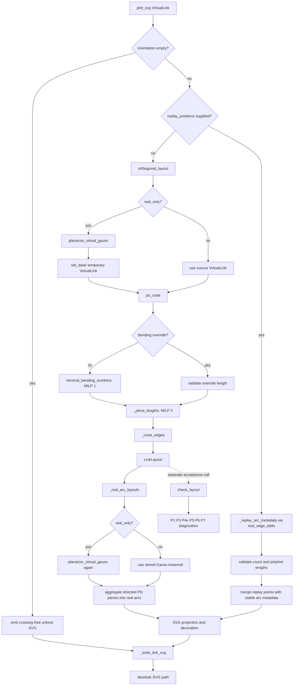
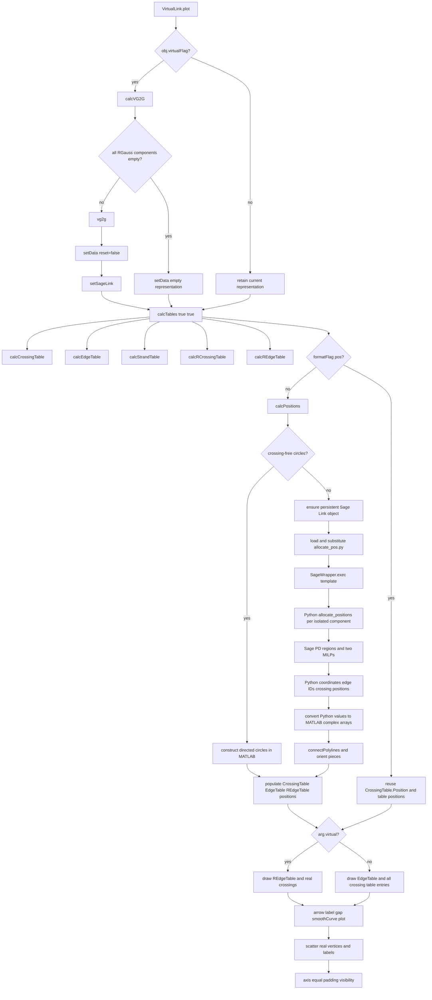

# VirtualLink o-graph plot specification

Status: normative specification for the Julia `VirtualLink` plot path<br>
Scope: `Topology.plot_svg(::VirtualLink, ...)` and its Julia-native layout dependency closure<br>
Audience: implementers, reviewers, test authors, and QMD authors<br>
Owner context: 東京科学大学 情報理工学院 数理・計算科学系 鈴木咲衣研究室
Last verified against implementation: 2026-08-26

## 1. Purpose

This document specifies what a `VirtualLink` o-graph plot means, how it is
computed, which observable output is required, and how conformance is decided.
It is intentionally separate from [`PLOT_PIPELINE.md`](../../PLOT_PIPELINE.md): that
file is an audit and migration record; this file is the contract.

The plot operation has two distinct responsibilities:

1. compute or accept a routed geometric representation of a `VirtualLink`;
2. emit a self-contained SVG encoding its real arcs, real crossings, directions,
   optional weights, labels, and accessibility metadata.

A file being emitted is not by itself evidence that the geometric layout is
valid. Rendering and geometric acceptance are separate contracts (§11).

## 2. Normative language

The keywords **MUST**, **MUST NOT**, **SHOULD**, **SHOULD NOT**, and **MAY** are
normative.

- **MUST / MUST NOT**: required for conformance.
- **SHOULD / SHOULD NOT**: expected unless a documented reason justifies a
  deviation.
- **MAY**: optional behavior.

## 3. Public API

```julia
plot_svg(
    v::VirtualLink,
    path::AbstractString;
    bending_numbers=nothing,
    edge_labels=:weight,
    replay_positions=nothing,
) -> String
```

The return value MUST be the absolute path of the written SVG.

### 3.1 Arguments

| Argument | Contract |
|---|---|
| `v` | Source `VirtualLink`; MUST satisfy the data invariants in §4. |
| `path` | Destination filename. Its parent directory MUST already exist and be writable. The implementation does not create it. |
| `bending_numbers` | Optional debugging/layout override. If supplied, it MUST contain one integer per edge of the PD code returned by `pd_code` for this plot operation. It is ignored by the replay branch. |
| `edge_labels` | Callers MUST use one of `:none`, `:weight`, `:id`, or `:all`; semantics are in §9.6. |
| `replay_positions` | Optional sequence containing one polyline per real arc in stable `real_edge_table` order. When supplied, it bypasses planarisation, PD construction, both MILPs, and routing. |

### 3.2 Branch selection

The API MUST select exactly one of three branches:

1. **Crossing-free branch**: `isempty(v.orientation)`.
2. **Julia-native branch**: crossings exist and `replay_positions === nothing`.
3. **Replay branch**: crossings exist and `replay_positions !== nothing`.

`replay_positions` takes precedence over `bending_numbers`; a caller SHOULD NOT
supply both.

## 4. VirtualLink input contract

The source type is:

```julia
mutable struct VirtualLink
    gauss::Vector{Vector{Int}}
    orientation::Vector{Int}
    weights::Vector{Vector{Float64}}
    real_only::Bool
    is_weighted::Bool
    strand_types::Vector{Char}
end
```

### 4.1 Gauss data

For every nonzero crossing label `i`:

- `abs(i)` MUST be in `1:length(v.orientation)`;
- `i` MUST occur exactly twice across all components, ignoring sign;
- zero MAY appear exactly once at the end of an open/cut component and is not a crossing.
  `Int[]` is a crossing-free closed circle; `[0]` is a crossing-free open interval.

The sign of a Gauss entry records the local signed crossing visit used by
`pd_code` and real-arc traversal.

### 4.2 Crossing orientation

- `+1` and `-1` denote real crossings and select the signed local crossing
  convention.
- `0` denotes an inserted or supplied virtual crossing. It has no real
  over/under topological information, MUST be excluded from real-crossing
  tables/vertices, and MUST remain `0` in stored and returned orientation data.
- PD construction and geometric routing still require a cyclic local frame at
  a virtual crossing. For those representation-only calculations, `0` MUST use
  the `+1` slot/turn convention, matching Sage `Link.orientation()` and MATLAB's
  `ori_(ori_==0)=1`. This MUST NOT reclassify the crossing as real.
- If `v.orientation == Int[]`, crossing-free circles and open intervals are
  distinguished by their component markers.
- If `v.orientation` is nonempty, it MUST contain at least one nonzero entry and
  the diagram MUST induce at least one real arc. An all-virtual nonempty diagram
  is outside the current rendering contract.
- If `v.real_only == true`, the input MUST contain no zero orientation. The
  planarisation stage may insert zero-orientation crossings.

### 4.3 `real_only`

`real_only == true` means the Gauss input is a real-Gauss/o-data description
that still requires virtual planarisation before orthogonal layout.

`real_only == false` means the stored Gauss code is already the plot input. It
may contain real and virtual crossings as indicated by `orientation`.

### 4.4 Weights

Weights are indexed by component and then by real arc in traversal order.

- When `is_weighted == true`, each real arc SHOULD have a corresponding finite
  weight.
- Missing weights are represented internally by `NaN` and MUST NOT produce a
  textual weight label.
- Plotting MUST NOT mutate weights.

### 4.5 Non-mutation

`plot_svg` and every layout stage MUST treat `v` as read-only. Temporary
planarised links MUST be separate objects.

## 5. Normative call graph

### 5.1 Full call graph



### 5.2 Canonical linear form

```text
NORMAL BRANCH
VirtualLink
  → [planarize_virtual_gauss → temporary VirtualLink, when real_only]
  → pd_code
  → minimal_bending_numbers or validated override
  → _piece_lengths
  → _route_edges
  → LinkLayout
  → _real_arc_layouts
  → gap / rounded path / arrow / labels / vertices
  → _write_link_svg
  → absolute SVG path

REPLAY BRANCH
VirtualLink
  → real_edge_table
  → stable real-arc metadata
  + replay_positions
  → replay consistency checks
  → gap / rounded path / arrow / labels / vertices
  → _write_link_svg
  → absolute SVG path
```

### 5.3 Acceptance is not in the render call graph

`plot_svg` currently does not call `check_layout`. A caller that needs a
certified Julia-native plot MUST run:

```julia
layout = orthogonal_layout(v; bending_numbers=bending_numbers)
diagnostics = check_layout(layout)
isempty(diagnostics) || error("layout is not conforming")
plot_svg(v, path; bending_numbers=bending_numbers)
```

A future checked convenience API MAY combine these operations, but it MUST NOT
silently redefine `plot_svg` output as proof of geometric validity.

## 6. Layout-stage contracts

### 6.1 Virtual planarisation

```julia
planarize_virtual_gauss(
    real_gauss,
    real_orientation;
    DEBUG_MODE::Bool=false,
    debug_io::IO=stderr,
) -> (gauss, orientation)
```

This stage MUST:

- preserve the ordered real crossing visits;
- insert only virtual crossings for planarisation;
- append orientation `0` for each inserted virtual crossing;
- return a representation accepted by `set_data!` and `pd_code`;
- leave the source arrays unchanged.

When `DEBUG_MODE == true`, this stage MUST additionally:

- emit stable checkpoints containing strand/visit/face identity, strand edge
  sequences, region vertex boundaries, region edge boundaries, face-graph edges
  with their boundary incidences, Gauss code, and orientation to `debug_io`;
- validate that the face graph and region boundaries describe the same nonzero
  edge IDs;
- validate face counts, boundary lengths, and graph endpoint ranges;
- validate that real crossing order and orientation are unchanged and every
  inserted crossing has orientation `0`;
- fail at the first violated invariant with the checkpoint phase in the error.

The maintained MATLAB comparison path is
[`scripts/matlab/export_vg2g_json.m`](../../scripts/matlab/export_vg2g_json.m),
which calls the Sage-independent `VirtualLink.debugVG2G` entry. Run
[`scripts/compare_vg2g.jl`](../../scripts/compare_vg2g.jl) to compare the
MATLAB and Julia Gauss/orientation outputs on the `VLExample` Virtual-Gauss
catalog. The exact MATLAB R2025b outputs are retained in
[`test/fixtures/vg2g_matlab_v1.json`](../../test/fixtures/vg2g_matlab_v1.json)
so the five parity cases remain executable without launching MATLAB.

A second invocation currently occurs in `_real_arc_layouts`. Both invocations
MUST return identical results for the same input. Duplicate execution is an
implementation debt, not a semantic feature.

### 6.2 PD-code construction

```julia
pd_code(v) -> Matrix{Int}  # one row per crossing, four slots
```

The row convention MUST be the Sage 10.1+ convention used by this project:
start at the entering under-strand and walk counter-clockwise. Orientation
`-1` and non-`-1` select the two existing slot arrangements in
[`src/virtual_link.jl`](../../src/virtual_link.jl).

Any external per-edge data MUST be indexed to the labels returned by this
`pd_code` call. A PD supplied earlier to `set_data!` is not a stable label
oracle because the PD→Gauss→PD round trip may relabel edges.

### 6.3 Minimum-bend MILP

```julia
minimal_bending_numbers(pd) -> Vector{Int}
```

This stage MUST:

- solve the integer region-flow model;
- require `MOI.OPTIMAL` termination;
- minimize the sum of nonnegative bend-flow variables;
- return one signed bend number per sorted unique PD edge.

The optimum need not be unique. Conformance MUST compare the objective and
geometric properties, never an exact bending vector or stored coordinates.

### 6.4 Segment-length MILP

```julia
_piece_lengths(pd, bending) -> Dict
```

This stage MUST:

- assign integer segment lengths with lower bound one;
- impose horizontal and vertical region-closure constraints;
- require `MOI.OPTIMAL` termination;
- minimize total segment length;
- return the total length of each edge piece.

Direction bucketing uses `direction % 4` uniformly. This is the normative Julia
behavior unless a later specification revision explicitly changes it.

### 6.5 Edge routing

```julia
_route_edges(pd, orientation, bending, lengths)
    -> (crossing_positions, edge_layouts)
```

Each returned `EdgeLayout` MUST contain:

- stable PD edge `id`;
- an ordered polyline with at least two lattice points;
- tail and head crossing indices;
- tail and head PD slots.

Every segment MUST be axis-parallel. Every edge MUST begin and end at its own
recorded crossings. A closing/cycle edge encountered after its target was
positioned MUST be routed from whichever endpoint produces the required stored
closure; it MUST NOT silently terminate at another coordinate.

Disconnected PD components are not supported by the current router and MUST
raise `ArgumentError("disconnected PD component is not yet positioned")` rather
than return a partial layout.

### 6.6 LinkLayout

```julia
struct LinkLayout
    pd::Matrix{Int}
    crossings::Vector{ComplexF64}
    edges::Vector{EdgeLayout}
    bending_numbers::Vector{Int}
    orientation::Vector{Int}
end
```

Coordinates are expressed in layout lattice units. Positive imaginary values
are upward in layout space. Projection to SVG reverses the y axis.

## 7. Real-arc aggregation

`_real_arc_layouts` MUST aggregate routed PD edges into oriented real arcs
matching `real_edge_table(v)` traversal semantics.

For each closed component:

1. remove zero cut markers;
2. identify visits whose crossing orientation is nonzero;
3. collect all routed pieces from the previous real crossing through the target
   real crossing, including intervening virtual crossings;
4. concatenate adjacent pieces without duplicating shared endpoints;
5. assign arc IDs sequentially in component/traversal order;
6. attach source, target, and corresponding component weight.

The signs of `source` and `target` are semantically significant:
negative endpoints are under-strand endpoints and receive a crossing gap in the
SVG stage.

If no directed PD piece exists for a required Gauss pair, aggregation MUST raise
an `ArgumentError` rather than omit the arc.

### 7.1 Cut components

`plot_svg` keeps actual cut real-edge identities and weights. For a component
with real crossings it may obtain coordinates from a temporary closed layout,
then split the closure arc into two separated half-arcs. The two boundary edges
MUST use different IDs from the actual cut `real_edge_table`; their endpoints
are `(strand,:in)` and `(strand,:out)`, never one shared crossing numbered zero.
The temporary closure is a coordinate scaffold only and MUST NOT be used for
disk equations, move semantics or invariants. Boundary markers and labels are
rendered explicitly. Pure open intervals have their own line geometry.

Direct `orthogonal_layout` and the closed-PD face helpers remain closed-only;
callers of cut diagrams use `plot_svg`. Replay polylines have one entry per
actual real edge, including both boundary edges, and distinct zero endpoints
are not required to coincide.

`plot_circuit_b_svg` is a separate combinatorial view of actual directed disk
paths: every signed edge occurrence is retained, and its endpoint lane labels
come from `disk_table.boundary_start/end`. It is not an o-graph embedding.

## 8. Replay branch

The replay branch exists for comparison and externally supplied geometry. It is
not the primary acceptance path.

### 8.1 Stable ordering

`replay_positions[i]` MUST correspond to the `i`th record returned by
`real_edge_table(v)` / `_replay_arc_metadata(v)`.

### 8.2 Validation

The branch MUST reject:

- a replay array whose count differs from the real-arc count;
- a polyline with fewer than two points;
- multiple replay arc endpoints assigning different coordinates to the same
  crossing, with tolerance `1e-9`.

The replay branch MUST NOT invoke the layout solver. Therefore layout-property
acceptance of a replay must be established separately if required.

## 9. SVG rendering contract

### 9.1 Coordinate system and fitting

- Layout geometry is measured in lattice units.
- Projection MUST map `x + yi` to SVG `(x, -y)`.
- The `viewBox` MUST fit all arc points and displaced labels plus
  `LINK_STYLE.margin`.
- Pixel width and height MUST be derived from lattice extent using
  `LINK_STYLE.px_per_unit`.

### 9.2 Style constants

The current normative style is:

```julia
LINK_STYLE = (
    strand = 0.07,
    arrow = 0.06,
    gap = 0.18,
    radius = 0.28,
    vertex = 0.115,
    font = 0.32,
    margin = 0.7,
    px_per_unit = 72,
)
```

These values are in lattice units except `px_per_unit`. Changing them is a
visible specification change and SHOULD include regenerated acceptance
artifacts.

### 9.3 Crossing gap

At each negative signed real-arc endpoint, the renderer MUST shorten the arc by
`LINK_STYLE.gap` along the first or last segment. Positive endpoints MUST remain
unshortened. This creates the under-strand opening at a crossing.

### 9.4 Rounded orthogonal paths

- Straight portions MUST follow the routed polyline.
- Interior corners MUST use quadratic SVG `Q` segments.
- Requested corner radius is `LINK_STYLE.radius`.
- Local radius MUST be capped at `0.45` times each adjacent segment length.
- Zero-length adjacent segments MUST fall back to an ordinary line command.

The rounding operation MUST NOT change arc endpoints.

### 9.5 Direction arrows

Every real arc MUST have one arrow.

- Position: arc-length midpoint of the unprojected polyline.
- Direction: local unit tangent in source→target traversal direction.
- The arrow MUST remain independent of the number of polyline corners.

### 9.6 Edge labels

| `edge_labels` | Arc ID | Weight |
|---|---:|---:|
| `:none` | no | no |
| `:weight` | no | yes, when `v.is_weighted` and finite |
| `:id` | yes | no |
| `:all` | yes | yes, when `v.is_weighted` and finite |

Arc IDs MUST be rendered as `E<n>`. Integer-valued real weights MUST render
without a decimal tail. Labels MUST be placed beside the arc, to the left of
travel, and then separated by the label-overlap relaxation.

The current implementation does not reject an unknown `edge_labels` value; that
is a conformance gap. Callers MUST NOT rely on unknown values behaving like
`:none`.

### 9.7 Real crossing vertices

Only crossings with nonzero orientation are visible vertices.

- Each visible crossing MUST be rendered as a filled circle.
- Labels MUST be `V1`, `V2`, … in visible real-crossing order.
- Labels SHOULD be displaced away from the diagram centroid and then passed
  through overlap relaxation.
- Virtual crossings MUST NOT receive a visible vertex marker.

### 9.8 Crossing-free unknot

When `v.orientation` is empty, the result MUST be a dedicated unknot SVG:

- one circle;
- one direction arrow;
- title `unknot`;
- description identifying one closed component and no crossings;
- metadata `crossings=0; arcs=0; weighted=false`.

This branch does not run layout or replay validation.

### 9.9 Theme and accessibility

The output MUST be a self-contained SVG containing:

- `role="img"` and an `aria-label`;
- `<title>`;
- a nonempty `<desc>` for nontrivial plots;
- `<metadata><ograph>…</ograph></metadata>`;
- an explicit background rectangle;
- light and dark color variables using `prefers-color-scheme`;
- presentation attributes as a renderer-compatible fallback.

For a nontrivial plot:

- title MUST derive from the destination basename without extension;
- description MUST state real crossing count, arc count, and source Gauss code;
- metadata MUST state crossing count, arc count, and weighted status.

### 9.10 File-format requirements

- The file MUST contain one top-level `<svg>` element.
- Arc paths MUST use class `arc` and `data-arc="<id>"`.
- Direction paths MUST use class `arrow`.
- Vertex circles MUST use class `vertex`.
- Labels MUST use class `label`.
- Emission MUST avoid trailing horizontal whitespace.

## 10. Error contract

The normal branch MUST fail rather than return knowingly incomplete geometry for:

- non-optimal minimum-bend MILP;
- non-optimal segment-length MILP;
- bending override length mismatch;
- disconnected PD component;
- missing directed PD edge during real-arc aggregation.

The replay branch MUST fail for the validation errors in §8.2.

Filesystem errors from opening or writing `path` MAY propagate unchanged.

`plot_svg` currently does not fail merely because `check_layout` would report a
property violation. Such output is rendered evidence, not accepted geometry.

## 11. Conformance and acceptance

### 11.1 Three levels

A result MUST be described using one of these levels:

| Level | Meaning |
|---|---|
| **R — rendered** | The call returned an SVG path; the file is nonempty and structurally parseable. No geometric claim follows. |
| **G — geometry-conforming** | The Julia-native `LinkLayout` passes every rule in §11.2 and the MILPs terminated optimally. |
| **V — visually reviewed** | Level G plus human inspection confirms labels, crossing gaps, arrows, and framing are readable. |

“Plot supported” without a level is ambiguous and SHOULD NOT be used in audit
or QMD prose.

### 11.2 Mandatory geometric properties

A geometry-conforming plot MUST have no error diagnostic for:

| Rule | Requirement |
|---|---|
| P1 | Every segment is horizontal or vertical. |
| P3 | Every edge begins at its tail crossing and ends at its head crossing. |
| P4v | Every crossing coordinate has exactly four incident edge-ends; no edge-end terminates away from a crossing. |
| P5 | Crossing coordinates are pairwise distinct. |
| P6 | Distinct segments meet only at crossing coordinates and never overlap over a span. |
| P7 | No edge passes through a crossing to which it is not incident. |

The executable oracle is:

```julia
check_layout(layout)
is_valid_layout(layout)
failing_rules(layout)
```

An empty diagnostic set establishes only these geometric properties. It does
not independently prove bend optimality; optimality follows from successful
MILP termination or must be checked separately for externally supplied layouts.

### 11.3 No coordinate oracle

Conformance MUST NOT require equality with:

- a stored MATLAB figure;
- a stored bending vector;
- one specific GLPK optimum;
- one specific coordinate embedding.

The minimum-bend model is degenerate. Distinct optimal embeddings are allowed if
they satisfy the normative properties.

## 12. Unsupported and out-of-scope behavior

The current Julia-native plot contract does not guarantee:

- disconnected PD components;
- `_isolated_components` placement;
- `component_gap` separation;
- separate unknot circles inside a multi-component nonempty diagram;
- abalone reversal compatibility;
- equivalence to MATLAB/Sage curve geometry;
- a stable coordinate identity across solver versions;
- automatic geometric validation inside `plot_svg`;
- mutation or persistence of diagram state in Sage.

These are not silently implied by successful SVG emission.

## 13. Required tests

### 13.1 API and output

Tests MUST cover:

- ordinary Julia-native plot;
- crossing-free unknot;
- weighted plot;
- every supported `edge_labels` mode;
- replay count mismatch;
- replay polyline shorter than two points;
- replay crossing-coordinate disagreement;
- missing destination parent / write failure propagation;
- absolute-path return;
- parseable SVG and required accessibility metadata.

### 13.2 Geometry

The acceptance corpus MUST run `check_layout` on every Julia-native layout and
record diagnostics per call. Aggregate “SVG count” or “test passed” summaries
MUST NOT replace per-instance property results.

### 13.3 Routing regressions

Regression tests SHOULD include:

- a self-loop;
- an edge closing an already positioned cycle;
- a virtualised real-Gauss input;
- a weighted multi-component input;
- a diagram where multiple minimum-bend optima exist.

### 13.4 Visual review

Contact sheets MAY support visual review, but MUST NOT substitute for P1–P7.
Visual review SHOULD specifically inspect:

- under-strand gaps;
- arrow orientation and midpoint placement;
- vertex/edge label collisions;
- clipping by the viewBox;
- dark-theme readability;
- self-crossing or component overlap not apparent from incidence alone.

## 14. Traceability matrix

| Specification concern | Implementation source | Executable evidence |
|---|---|---|
| `VirtualLink` state and validation | [`src/virtual_link.jl`](../../src/virtual_link.jl) | `test/runtests.jl` data tests |
| Virtual planarisation | [`src/virtual_planarization.jl`](../../src/virtual_planarization.jl) | planarisation tests and plot corpus |
| PD code and regions | [`src/virtual_link.jl`](../../src/virtual_link.jl) | `test/runtests.jl` |
| MILP 1 / MILP 2 / routing | [`src/orthogonal_layout.jl`](../../src/orthogonal_layout.jl) | layout tests, `scripts/check_all_layouts.jl` |
| Arc aggregation / SVG semantics | [`src/svg_plot.jl`](../../src/svg_plot.jl) | SVG tests, plot corpus |
| P1–P7 | [`src/layout_invariants.jl`](../../src/layout_invariants.jl) | `scripts/check_all_layouts.jl` |
| Corpus generation | [`examples/VLExample.jl`](../../examples/VLExample.jl), [`examples/OgraphPlotSuite.jl`](../../examples/OgraphPlotSuite.jl) | `artifacts/julia_plots/` |
| Historical audit and known divergences | [`PLOT_PIPELINE.md`](../../PLOT_PIPELINE.md) | parity harnesses under `scripts/sage/` |
| Live Script coverage | [`LIVESCRIPT_PORTS.md`](../../LIVESCRIPT_PORTS.md) | source-state comparison scripts |

## 15. Example: checked Julia-native rendering

```julia
using Topology

v = VirtualLink()
set_data!(v;
    rgauss = [[1, -2], [-1, 2]],
    orientation = [1, 1],
)

layout = orthogonal_layout(v)
diagnostics = check_layout(layout)
isempty(diagnostics) || error(join(string.(diagnostics), "\n"))

path = plot_svg(v, "hopf.svg"; edge_labels=:id)
@assert isabspath(path)
```

## 16. Example: replay rendering

```julia
using Topology

v = VirtualLink()
set_data!(v;
    rgauss = [[1, -2], [-1, 2]],
    orientation = [1, 1],
)

# One polyline per real_edge_table(v) record, in the same order. This simple
# fixture places each crossing k at (k, 0); production replay data normally
# comes from MATLAB REdgeTable.Position.
edges = real_edge_table(v)
positions = [
    ComplexF64[
        complex(abs(edge.crossing[1]), 0),
        complex(abs(edge.crossing[2]), 0),
    ]
    for edge in edges
]

plot_svg(v, "hopf-replay.svg"; replay_positions=positions)
```

Replay coordinates are supplied evidence. This call does not establish
minimum-bend optimality or P1–P7 unless those properties are checked separately.

## 17. Specification-change policy

A change requires specification review when it alters any of:

- public arguments or return value;
- PD or orientation convention;
- arc ordering;
- MILP objective or constraints;
- routing closure behavior;
- crossing-gap semantics;
- arrow position or direction;
- label modes;
- visible crossing selection;
- style constants;
- accessibility metadata;
- P1–P7 meaning;
- unsupported-feature boundary.

Implementation-only refactoring that preserves every contract above does not
require a specification revision, but MUST retain the corresponding tests.

## 18. MATLAB implementation scope

The remainder of this document records the current MATLAB plot path so that a
Julia caller, port author, or QMD author can identify which behavior is shared,
which behavior is MATLAB-specific, and where state crosses the MATLAB/Python/
Sage boundary.

This is a compatibility description of the current source, not an instruction
that Julia MUST reproduce every MATLAB coordinate or implementation defect.
The Julia normative acceptance rules remain §§3–17.

MATLAB source identity:

- [`VirtualLink.m`](../../../topology/Manifold/VirtualLink/VirtualLink.m)
- [`allocate_pos.py`](../../../topology/Manifold/VirtualLink/allocate_pos.py)
- [`SageWrapper.m`](../../../topology/SW/SageWrapper.m)

### 18.1 MATLAB public plot API

```matlab
p = plot(obj, NameValueArgs)
```

The declared name-value arguments are:

| Argument | Default | Current role |
|---|---:|---|
| `virtual` | `true` | Select `REdgeTable`/`RCrossingTable` (`true`) or full `EdgeTable`/`CrossingTable` (`false`) for drawing. |
| `cut` | `[]` | Optional cut-edge indices; inferred from `obj.isCut` when empty. |
| `smooth` | `true` | Apply `smoothCurve(..., 0.3)` before drawing non-circle arcs. |
| `color` | `'b'` | Strand, arrow, and vertex color. |
| `lineWidth` | `1` | Strand and arrow line width. |
| `markerSize` | `20` | Real-crossing scatter size. |
| `coordinate` | `false` | Keep axes/grid visible when true; otherwise call `axis off`. |
| `edgeLabel` | `"weight"` | One of `none`, `ID`, `weight`, `all`. |
| `vertexLabel` | `"all"` | Declared as `none`, `ID`, `ori`, `all`; not currently applied by the drawing body. |
| `vertexStyle` | `"real"` | Declared as `none`, `real`, `imag`, `all`; not currently applied by the drawing body. |
| `gap` | `0.2` | Used for vertex-label offset; arc shortening currently uses a separate hard-coded `0.2`. |
| `componentGap` | `1` | Used by the crossing-free circle branch. The ordinary Python template currently hard-codes `0.5`, so the attempted `COMPONENT_GAP` substitution has no target. |
| `bendingNumbers` | `{}` | Optional per-isolated-component bend vectors passed to Python. |
| `printBendingNumbers` | `false` | Injected into the Python template. |

The method declares output `p`, but the current body does not assign it. Callers
MUST treat `plot(obj, ...)` as a side-effecting figure operation and SHOULD NOT
request or depend on a return value until the MATLAB implementation defines one.

## 19. MATLAB call graph

### 19.1 Main flow



### 19.2 Process and state boundaries

```text
MATLAB VirtualLink.plot
  → MATLAB object/table preparation
  → SageWrapper.H singleton
      → MATLAB pyenv embeds one native Python interpreter
      → import sage.all
      → retain sage.all.__dict__ as persistent namespace
      → store diagram as namespace variable obj.sageName
  → execute substituted allocate_pos.py inside that namespace
      → Sage Link.pd_code / orientation / regions / isolated components
      → Sage MixedIntegerLinearProgram × 2
      → Python coordinate/control-point extraction
  → Python values returned through py.eval
  → MATLAB conversion, arc reconstruction, caching, and graphics
```

### 19.3 Alternative `plotSage` flow

`VirtualLink.plotSage` is a separate path and is not called by
`VirtualLink.plot`:

```text
plotSage
  → SageWrapper.H.exec("img=<sageName>.plot()")
  → Sage save_image(tmpknotimage.png)
  → MATLAB imshow
  → delete temporary PNG
```

It renders Sage's own plot into a PNG. It does not exercise MATLAB's
`calcPositions`, tables, labels, gaps, or smoothing and is not an oracle for the
ordinary MATLAB plot path.

## 20. MATLAB stage contracts

### 20.1 `calcVG2G`

When `obj.virtualFlag` is true, `plot` mutates the object before table and
position computation. For a nonempty real-Gauss input the flow is:

```text
RGaussCode + ROrientation
  → vg2g
  → setData(reset=false, GaussCode=gc, orientation=ori)
  → setSageLink
```

The conversion inserts virtual crossings needed for visualisation and then
refreshes the persistent Sage object. Unlike the Julia path, planarisation is
not isolated in a temporary `VirtualLink`; it changes MATLAB object state.

If every `RGaussCode` component is empty, `calcVG2G` instead calls
`setData(reset=false, ...)` and returns without invoking `vg2g` or
`setSageLink`. The later crossing-free branch in `calcPositions` is then
responsible for geometry.

### 20.2 `calcTables([true,true])`

The first flag computes or reuses:

- `CrossingTable`;
- `EdgeTable`;
- `StrandTable`.

The second computes or reuses:

- `RCrossingTable`;
- `REdgeTable`.

Each table function uses `formatFlag` as a cache guard. `calcREdgeTable`
constructs real arcs by traversing Gauss components between nonvirtual
crossings, remaps crossing IDs to the real-crossing index set, and carries
weights into that traversal order.

### 20.3 Position-cache branch

`plot` calls `calcPositions` only when `formatFlag("pos")` is false. Otherwise it
reuses stored positions, including `CrossingTable.Position`, `EdgeTable.Position`,
and `REdgeTable.Position` previously attached to the mutable object.

Consequences:

- plotting is not a pure function of the arguments visible at the call site;
- callers that mutate diagram/table state MUST ensure position flags are
  invalidated by the mutation path;
- changing layout options after positions were cached may not recompute
  geometry;
- a call-flow trace MUST record whether the `pos` cache branch was taken.

### 20.4 Persistent Sage object

`setSageLink` serializes either Gauss/orientation data or PD data and executes:

```python
<obj.sageName> = Link(<serialized data>)
```

inside `SageWrapper.H.ns`. `sageLinked` records the expected existence of that
variable; object deletion attempts `del <sageName>`.

At position time, `calcPositions` first evaluates `obj.sageName`. If that fails,
it calls `setSageLink`. The main allocation script and a later edge-direction
query both refer to the same persistent namespace variable.

Therefore an external bridge that starts a fresh Sage process per request is not
compatible with this flow unless every request reconstructs the `Link` and all
required state.

### 20.5 Python template execution

`calcPositions` reads `allocate_pos.py` and attempts substitutions for:

```text
LINK
PRINT_BENDING_NUMBERS
BENDING_NUMBERS
COMPONENT_GAP
NCIRCLE
```

It then sends the entire string array to `SageWrapper.exec`. All lines except the
last are executed with `py.builtins.exec`; the last expression is evaluated with
`py.eval` and returned to MATLAB.

The current Python source returns:

```text
[coords, edgeID, pos_crossings]
```

recursively converted to ordinary floats.

### 20.6 Python/Sage layout flow

For each isolated Sage component, `allocate_positions` performs:

```text
Link.pd_code
  → Link.orientation
  → Link.regions
  → minimum-bend MixedIntegerLinearProgram
  → optional bending-number override
  → segment decomposition
  → segment-length MixedIntegerLinearProgram
  → crossing placement and edge walk
  → line/quadratic/cubic control-point extraction
```

The outer script then:

1. calls `LINK._isolated_components()`;
2. lays out each component independently;
3. offsets each later component in x;
4. reverses each coordinate list for a one-entry component as an exceptional
   abalone workaround;
5. appends square control data for `NCIRCLE` unlink components;
6. returns PD-indexed crossing positions.

The Python file currently sets `component_gap = 0.5` literally. The MATLAB
`strrep(..., "COMPONENT_GAP", ...)` call therefore does not alter ordinary
component separation in this source revision.

### 20.7 MATLAB conversion and table population

`calcPositions` converts Python `[x,y]` pairs to MATLAB complex values, groups
coordinate fragments by Python `edgeID`, and orders/connects each group with its
nested `connectPolylines` helper.

It then issues a second Sage query, `_directions_of_edges()`, to obtain signed
crossing incidence for the sorted Sage edges. MATLAB may reverse an edge's
coordinate sequence when its endpoint does not match the expected crossing.
Self-loops receive additional handling:

- optional `2/3` shrink;
- tangent-consistency check;
- insertion of an extra point for four-point loop control data.

Finally it writes:

- `CrossingTable.Position`;
- `EdgeTable.Position` and `EdgeTable.ID`;
- `REdgeTable.Position`, aggregated from the edge table by real-arc traversal;
- `formatFlag("pos") = true`.

`connectPolylines` removes point-only fragments, orders pieces by matching
endpoints, removes duplicate connection points, and raises
`connectPolylines:NoMatch` when it cannot construct one chain containing every
piece.

## 21. MATLAB drawing semantics

### 21.1 Table selection

With default `virtual=true`, drawing uses `REdgeTable` and `RCrossingTable`; the
virtual crossings used internally for planarisation are not drawn as vertices.
With `virtual=false`, it uses the full edge and crossing tables.

### 21.2 Edge labels

- `ID` uses `TE.Label`, falling back to `E<n>`.
- `weight` renders `TE.Weight` only when `obj.isWeighted`.
- `all` joins ID and weight.
- `none` produces no edge text.

The label is placed at the midpoint of the selected central polyline segment,
not the arc-length midpoint.

### 21.3 Arrows

For an ordinary closed arc, MATLAB chooses:

```matlab
seg = segs(floor(end/2) + (0:1));
mp = mean(seg);
```

and constructs an arrow from that segment's unit direction. A cut arc whose
second crossing is zero places its arrow at the final endpoint. This differs
from Julia's arc-length-midpoint rule.

### 21.4 Crossing gap

The drawing body assigns `gap=0.2` independently of `arg.gap`. It shortens each
eligible start/end according to signed crossing incidence and crossing
orientation. Circle components are exempt.

`arg.gap` currently affects the offset of vertex labels but not this arc gap.

### 21.5 Curve smoothing

When `smooth=true`, each non-circle polyline is transformed by
`smoothCurve(segs, 0.3)`:

- each interior corner is trimmed by radius `0.3` along incoming/outgoing unit
  vectors;
- significant turns are sampled with 30 arc-angle points;
- long already-sampled closed circles are left unchanged;
- endpoints are preserved.

This produces sampled MATLAB polylines, not SVG quadratic commands. Numerical
curve identity with Julia's `_rounded_svg_path` is not required.

### 21.6 Vertices and axes

MATLAB draws only entries where `logical(obj.orientation)` is true, using
`scatter`. It then unconditionally emits `V1`, `V2`, … labels. The declared
`vertexLabel` and `vertexStyle` arguments do not currently control this body.

The plot uses equal axes and padded limits. Axes are hidden unless
`coordinate=true`. Additional limit padding is applied when an edge has
crossing pair `[0,0]`.

## 22. MATLAB crossing-free branch

Before invoking Sage, `calcPositions` detects:

```text
orientation empty
AND Ncircle > 0
AND every Gauss component empty
```

It constructs one analytically sampled directed unit circle per component,
separated by `3 * componentGap`, writes the positions into `REdgeTable`, marks
the position cache valid, and returns no crossing coordinates.

This branch is different from the Python template's later `NCIRCLE` square
fallback. For an entirely crossing-free `VirtualLink`, the MATLAB branch returns
before Python/Sage execution and is the operative behavior.

## 23. MATLAB-to-Julia correspondence

| Concern | MATLAB path | Julia path | Compatibility rule |
|---|---|---|---|
| Source object | mutable `VirtualLink` with tables and flags | compact `VirtualLink` value fields | Topological input semantics should agree; internal state layout need not. |
| Planarisation | `calcVG2G` mutates object, then `setSageLink` | temporary planarised `VirtualLink` | Real crossing traversal and virtual insertion must be audited; mutation behavior need not match. |
| PD/regions | persistent Sage `Link` | Julia `pd_code`, `regions` | Conventions must agree on measured inputs. |
| Minimum bends | Sage MILP, default backend | JuMP/GLPK | Compare optimal objective, never exact bend vector. |
| Segment lengths | Sage MILP | JuMP/GLPK | Region closure and positive integer lengths are semantic; coordinates may differ. |
| Isolated components | Python `_isolated_components` + x offsets | unsupported by current router | Julia must fail explicitly until supported. |
| Position ownership | cached in MATLAB tables | returned `LinkLayout`; SVG is stateless | Julia need not reproduce mutable cache semantics. |
| Real-arc aggregation | MATLAB `REdgeTable.Position` via `connectPolylines` | `_real_arc_layouts` | Arc traversal order, endpoints, direction, and weights are compatibility surfaces. |
| Under-strand gap | hard-coded `0.2` in MATLAB | `LINK_STYLE.gap == 0.18` | Visual values are intentionally not identical; each renderer follows its own declared style. |
| Corner smoothing | sampled circular arcs, radius `0.3` | SVG quadratic corners, radius `0.28` | Geometric acceptance, not curve-coordinate equality. |
| Arrow position | midpoint of the central segment | midpoint of the central nonzero segment | Direction and vertex avoidance should agree. |
| Vertex options | declared but currently ignored | real vertices always drawn/labeled | Julia contract is authoritative for Julia output. |
| Output | MATLAB figure; `p` currently unassigned | self-contained SVG path | Output types are intentionally different. |
| Acceptance | no automatic property gate in `plot` | `check_layout` is separate from `plot_svg` | Neither emitted figure alone certifies geometry. |

## 24. MATLAB call-flow observation points

A debugger, tracer, or instrumentation harness SHOULD record these boundaries:

| ID | Observation point | Evidence to capture |
|---|---|---|
| M1 | `VirtualLink.plot` entry | argument values, `virtualFlag`, `formatFlag("pos")`. |
| M2 | after `calcVG2G` | Gauss code, orientation, `sageName`, `sageLinked`. |
| M3 | after `calcTables` | table heights and real/full table selection. |
| M4 | `calcPositions` branch | cache hit, crossing-free hit, or Sage allocation. |
| M5 | before `SageWrapper.exec(allocate_pos)` | substituted options, but not unrelated namespace contents. |
| M6 | Python `allocate_positions` | PD code, regions, bend objective/vector, length objective. |
| M7 | Python return | fragment count, edge IDs, crossing positions, isolated-component offsets. |
| M8 | after MATLAB conversion | oriented `PE`, `CrossingTable.Position`. |
| M9 | after table population | `EdgeTable.Position`, `REdgeTable.Position`, cache flag. |
| M10 | draw loop | selected table, labels, shortened/smoothed coordinates, arrows. |
| M11 | plot exit | figure/axes identity and whether output `p` was requested. |

The minimum useful call trace is therefore:

```text
plot
  → [calcVG2G → setSageLink]
  → calcTables
  → [calcPositions
      → SageWrapper.exec
      → allocate_positions
      → SageWrapper.exec(_directions_of_edges)
      → connectPolylines]
  → MATLAB draw loop
```

A trace that begins only at `allocate_positions` misses the object mutation,
table/cache branch, and final MATLAB geometry changes, and is not a complete
MATLAB plot call flow.
